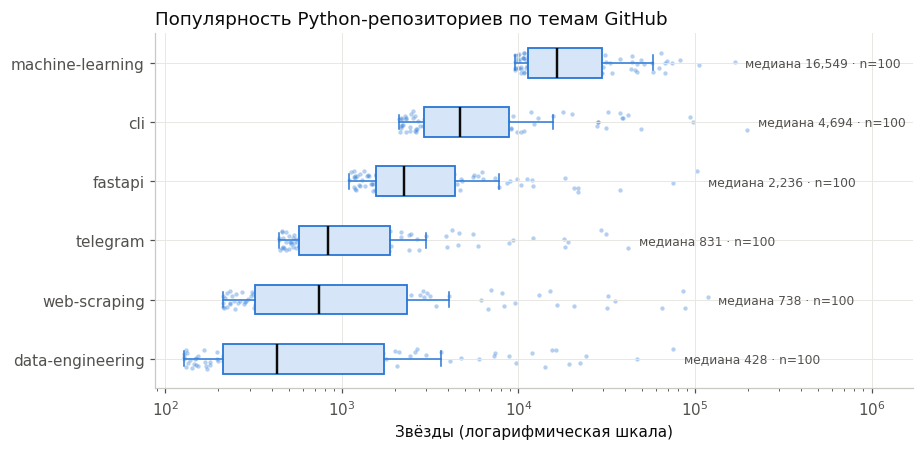

# Сбор данных из интернета: от REST API и парсинга до устойчивого пайплайна с оркестрацией в n8n

<!-- header -->
<p align="center">
  
  
  
  
  
  
</p>

<p align="center"></p>

Восемь работ по автоматизированному сбору данных: REST API, парсинг HTML, динамические страницы, промышленный краулинг,
хранение и контроль качества, устойчивость к сбоям. Итоговый проект — гибридный пайплайн: Python собирает и обрабатывает
данные, n8n запускает его по расписанию, проверяет отчёт о прогоне и рассылает оповещения.

## Задача и данные

Итоговый проект отвечает на вопрос, как популярность и активность Python-репозиториев связаны с их тематикой и размером.
Данные — карточки шести тем [github.com/topics](https://github.com/topics) (HTML) и метаданные репозиториев из GitHub
REST API, связанные по ключу `owner/repo`; реальный прогон — 15.10.2026.

## Результат

**Собрано 600 карточек тем и данные API по 592 репозиториям без отбраковки; при перепроверке условными запросами
(ETag) 208 из 225 ответов пришли с кодом 304 — квота GitHub API израсходована лишь на 16 запросов.**

* Медиана звёзд в теме machine-learning в 38,7 раза выше, чем в data-engineering (95 % бутстреп-интервалы не
  пересекаются); связь размера репозитория со звёздами — ρ Спирмена +0,47 (p ≈ 0,001).
* Пайплайн: robots.txt и паузы, водяной знак и UPSERT, снапшоты, 9 метрик качества с вердиктом, 7 порогов оповещения,
  отчёт о каждом прогоне и `RUN_SUMMARY` для n8n; отказ источника изолируется и записывается как инцидент.
* [README проекта](solutions/final_project_podolskiy/README.md), [анализ](solutions/final_project_podolskiy/analysis.ipynb),
  [слайды](solutions/final_project_podolskiy/slides.pdf).

## Работы

| Работа | Что сделано |
|---|---|
| [Лаб. 1](solutions/lab1/README.md) | REST API GitHub и NASA: запросы без ключа и с ключом из переменной окружения |
| [Лаб. 2](solutions/lab2/README.md) | парсинг учебного магазина: BeautifulSoup и Octoparse |
| [Лаб. 3](solutions/lab3_podolskiy_5/README.md) | CoinGecko API: пагинация при лимите частоты, обогащение 30-дневной историей; тот же сбор в n8n |
| [Лаб. 4](solutions/lab4_podolskiy_5/README.md) | динамические страницы с входом: Playwright, CSRF, `storage_state`, сравнение с requests |
| [Лаб. 5](solutions/lab5_podolskiy_5/README.md) | Scrapy-краулер каталога: robots.txt, кэш, JOBDIR, возобновление |
| [Лаб. 6](solutions/lab6_podolskiy_5/README.md) | хранение и качество: raw → clean → mart, контракт pydantic, SQLite с UPSERT и SCD2, Parquet, DuckDB |
| [Лаб. 7](solutions/lab7_podolskiy_5/README.md) | устойчивость: token bucket, повторы, предохранитель, ETag, структурные логи |
| [Итоговый проект](solutions/final_project_podolskiy/README.md) | гибридный пайплайн GitHub Topics + REST API с оркестрацией в n8n |

## Стек

Python · requests · BeautifulSoup · Scrapy · Playwright · pandas · pydantic · Parquet (PyArrow) · DuckDB · SQLite ·
PostgreSQL · n8n · Octoparse · pytest · Jupyter

## Структура и запуск

```
solutions/
├── lab1/ … lab7_podolskiy_5/   # у каждой работы свои README.md, report.md, requirements.txt, run_real.sh
└── final_project_podolskiy/
run_all.sh                       # реальный прогон лаб 3, 4, 5, 7
start_n8n.sh                     # n8n на http://localhost:5678 (нужен Node.js ≥ 24)
```

```bash
git clone https://github.com/Meta1rus/web-data-extraction.git && cd web-data-extraction
./run_all.sh          # лабы 3, 4, 5, 7 — около 40–50 минут, у каждой свой .venv и журнал logs/real_run_*.log
./run_all.sh 3        # одна лаба
./start_n8n.sh        # no-code части
```

Лаба 6 и итоговый проект уже прогнаны на реальном GitHub; повтор — `./run_all.sh --with-github` (нужен `GITHUB_TOKEN`
в `.env` соответствующей папки, `.env` в Git не попадает). Полные данные, которые не хранятся в репозитории, — в
[GitHub Release](https://github.com/Meta1rus/web-data-extraction/releases/tag/lab-data): `lab6_data.zip` (сырые ответы
GitHub API и базы SQLite лаб. 6, распаковать в `solutions/lab6_podolskiy_5/`) и `lab4_trace.zip` (Trace Viewer лаб. 4,
положить как `solutions/lab4_podolskiy_5/artifacts/trace.zip`).

---

Выполнено в рамках курса «Инструменты автоматизированного сбора данных в сети Интернет» магистратуры ПМИ ПГНИУ, 2026.
