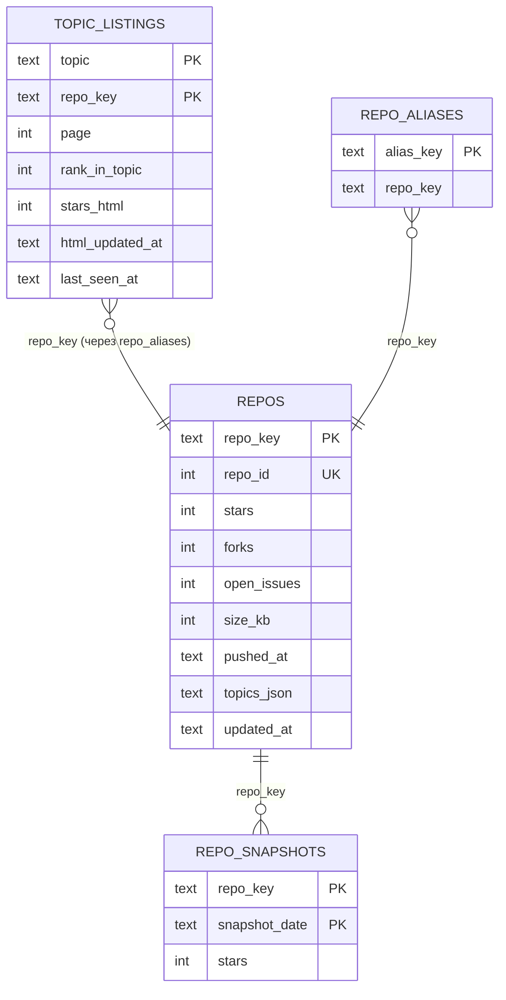

# Архитектурные решения: шесть осей защиты

**Подольский Ф. А., ПМИ-3-2025** · Конфигурация **B** (гибрид: код + n8n) · Связка источников № 5

**Исследовательский вопрос:** *Как популярность и активность Python-репозиториев связаны с их тематикой и размером?*

Вопрос проверяемый (три измеримых понятия: популярность — звёзды/форки/наблюдатели, активность — давность последнего
push и доля активных, размер — `size`) и требует объединения источников: тематику и выдачу даёт HTML-страница темы,
метрики — только API.

Цифры ниже — из реального прогона 15.10.2026 (21:22–21:51 UTC, Python 3.10, токен GitHub). Код, который их считает, —
`src/observability.py`, `src/quality.py`, `analysis.ipynb`. Вручную остаются только скриншоты (DevTools и n8n).

---

## 1. Выбор источников

| Вопрос защиты | Ответ |
|---|---|
| Почему эти источники отвечают на вопрос | Страница темы — «каталог» GitHub: тематическая принадлежность (самоописание автора), фильтр по языку `l=python` и порядок выдачи. REST API — единственный официальный источник метрик популярности, активности и размера репозитория. |
| Чем дополняют друг друга | HTML задаёт **совокупность по темам** (какие репозитории и в каких темах), API **обогащает** её метриками. Звёзды есть в обоих → независимая проверка парсера (метрика `stars_consistency_pct`). Дата «Updated» с карточки служит водяным знаком для экономии запросов к API. |
| Почему эти темы | Шесть «жанров» Python-проектов, различающихся размером и моделью поддержки: инструменты сбора данных (`web-scraping`), веб-сервисы (`fastapi`), тяжёлые исследовательские проекты с моделями и данными (`machine-learning`), инфраструктура данных (`data-engineering`), небольшие консольные утилиты (`cli`), массовые прикладные боты (`telegram`). Это даёт вариацию и по размеру, и по активности — без неё вопрос не имеет смысла. |
| Что делать, если один недоступен | HTML недоступен → ключи берутся из ранее собранных карточек (БД), обогащение продолжается; API недоступен → карточки обновляются, анализ идёт на ранее собранных метриках; в обоих случаях — инцидент, код 3, предсказуемая деградация (проверено на имитации, `demo/demo_failure.sh`). Если GitHub запретит сбор HTML — легальная альтернатива: Search API `topic:<t> language:python` (уже реализован как режим без токена) или открытый датасет GH Archive. |

## 2. Паспорта источников

| Параметр | HTML: страницы тем | API: GitHub REST |
|---|---|---|
| Тип | статический HTML (серверный рендеринг) | REST, JSON |
| Точка входа | `https://github.com/topics/<topic>?l=python[&page=N]` | `https://api.github.com/repos/{owner}/{repo}`; без токена — `/search/repositories` |
| Пагинация | «Load more…» = `GET` той же страницы с `page=N+1`; 20 карточек; стоп — нет карточек или нет следующей страницы; ≤ 5 страниц | поштучные запросы по ключам из HTML; Search — `Link: rel="next"`, `per_page=100` |
| Лимиты | официальных нет; `Crawl-delay` для `*` не задан → свой темп 0,33 запр/с + джиттер | 5000 запр/ч с токеном, 60 без; Search 30/10 запр/мин; вторичные лимиты (429/403 + `Retry-After`); 304 на авторизованный запрос квоту не расходует |
| Формат ответа | HTML, gzip | JSON (`application/vnd.github+json`, `X-GitHub-Api-Version: 2022-11-28`), заголовки `ETag`, `X-RateLimit-*` |
| Ключ уникальности | `owner/repo` из `href` карточки | `full_name` → `repo_key`; `id` — стабильный суррогат |
| Персональные данные | логин владельца в составе ключа; аватары не сохраняются | `owner.login`, `owner.type`; прочие поля владельца отбрасываются при сборе |
| Условия | robots.txt: `/topics/*` разрешено; AUP GitHub разд. 7 | ToS, документация API |

## 3. Выбор инструмента и протокол диагностики

**Протокол (занятие 4)** — `python src/collect_html.py --diagnose`, результат `reports/diagnostics_latest.json`:

| Шаг | Что проверяется | Результат |
|---|---|---|
| 1. Ответ сервера `requests` | код, размер страницы | 200, 642 474 байт (16.10.2026; 15.10.2026 — 642 581) (`/topics/web-scraping?l=python`) |
| 2. Поиск текста в исходном HTML | имя первого репозитория (`needle_in_html`), число карточек, найденных BeautifulSoup | BeautifulSoup нашёл 20 карточек из 20 (стратегия `article-cards`); имя первого репозитория `browser-use/browser-use` есть в исходном HTML |
| 3. Network → XHR | «Load more…» — `GET /topics/<t>?l=python&page=2` возвращает HTML с карточками (`load_more_target`) | форма «Load more…» ведёт на `https://github.com/topics/web-scraping?l=python` с `page=N+1` — обычный HTML, тот же парсер; `docs/screenshot_view_source.png` — фрагмент исходного HTML сохранённой страницы (имя первого репозитория, звёзды в `aria-label`, 20 карточек, форма «Load more…» с `page=2`); `docs/screenshot_network.png` — запрос после нажатия «Load more…» в браузере: GET `/topics/web-scraping?l=python&page=2` → 200, HTML (перехват Claude in Chrome, 16.10.2026) |
| 4. Вывод | браузер нужен, только если данных нет ни в HTML, ни в API | **достаточно HTTP** (requests + BeautifulSoup), Playwright не нужен |

Заранее, чтением реальной страницы `github.com/topics/web-scraping?l=python` (15.10.2026), подтверждено содержание:
20 репозиториев на странице, сортировка «Most stars», фильтр «Language: Python», у карточек — звёзды («71.3k»),
описание, теги, язык и «Updated <дата>», внизу — «Load more…». Это согласуется с серверным рендерингом; классы
разметки подтверждает первый реальный прогон (тест `test_real_page_if_present`).

**Почему requests + BeautifulSoup, а не Playwright:** данные есть в исходном HTML, догрузка — обычный GET; браузер
дал бы на порядок больше трафика и времени без новых данных. **Почему без Scrapy:** 30 страниц в сутки по одному
домену — очередь, приоритеты и параллелизм Scrapy не нужны; нужные свойства (лимит на домен, повторы, возобновление,
кэш для отладки) реализованы явно и покрыты тестами. **API — `requests`**: поштучные условные запросы с ETag и
водяной знак дают основную экономию; GraphQL (много репозиториев одним запросом) не используется, потому что не
поддерживает условные запросы и 304.

**Парсер устойчив к смене вёрстки:** три стратегии (карточки `article` → встроенный JSON на случай React →
ссылки `h3 a`), точное число звёзд из `aria-label`/`title` с фолбэком на «71.3k», детектор блокировки (код, маркеры,
размер, «200 без карточек»). Поломку селекторов покажут оповещения `html_no_cards`, `html_cards_drop_pct` и метрика
`stars_consistency_pct`.

## 4. Модель данных

* **Бизнес-ключ** — `owner/repo` в нижнем регистре (GitHub сравнивает имена без учёта регистра). Не URL: адрес
  меняется от параметров (`?l=`, `?tab=`), а ключ — нет. При переименовании API отвечает редиректом, `repo_id`
  прежний → старый ключ становится синонимом (`repo_aliases`), дубль в `repos` не возникает.
* **Связь сущностей:** карточка темы ⋈ репозиторий — многие к одному (репозиторий бывает в нескольких темах).
  Внешнего ключа нет намеренно: карточка может опережать обогащение; полноту связи меряет `join_coverage_pct`.
* **JSON-поля:** списки тем (`topics_json`, `tags_json`) — JSON-массивы с `CHECK (json_valid(...))`; в анализе они
  не соединяются, отдельная таблица не нужна.
* **История:** `repo_snapshots` — снимок метрик на дату проверки (200 и 304) → динамика за период сбора.
* **Аналитический слой обезличен:** в `mart/` вместо `owner/repo` — хэш `repo_ref`.

## 5. Границы качества

**Обязательные поля** (`RepoRecord`): `repo_key`, `repo_id`, `full_name`, `owner_login`, `stars`, `forks`,
`open_issues`, `size_kb`, `is_archived`, `is_fork`, `created_at`, `gh_updated_at`, служебные. `TopicListing`:
`topic`, `repo_key`, `page`, `rank_in_topic`, служебные.

**Правила контракта** (помимо типов и диапазонов): формат `owner/repo` по правилам GitHub; темы — slug a-z0-9-, без
повторов, ≤ 20; SPDX-идентификатор лицензии; все даты с часовым поясом (UTC); `repo_key = lower(full_name)`;
владелец в ключе совпадает с `owner.login`; `created_at` не позже момента сбора; `updated_at` не раньше `created_at`;
дата «Updated» на карточке не позже момента сбора. `pushed_at < created_at` намеренно **не** запрещено (импорт истории
— легальный случай), его доля — справочная метрика.

**Отбракованные записи** не теряются: `clean/rejects.jsonl` и таблица `rejects` (поле, причина, исходная запись,
прогон). Второй рубеж — CHECK в БД: строка, нарушившая ограничение, уходит в rejects, прогон не падает.

| Метрика (`src/quality.py`) | Зелёный / жёлтый | Обоснование порога |
|---|---|---|
| полнота обязательных полей, % | ≥ 99,5 / ≥ 98 | поля обязательны по контракту; пропуск звёзд/даты на карточке = поломка селектора |
| доля отбраковки, % | ≤ 2 / ≤ 5 | у официального API ошибок формата почти нет; рост — признак смены разметки/формата |
| уникальность ключа, % | 100 / ≥ 99,9 | дедупликация гарантирует 100 %; любое отклонение — ошибка конвейера |
| покрытие связи HTML → API, % | ≥ 95 / ≥ 80 | 404 (удалённые) и отбраковка дают единицы процентов; ниже 80 % анализ смещён |
| согласованность звёзд HTML и API, % | ≥ 90 / ≥ 75 | допуск 5 % покрывает округление «71.3k» и лаг; массовое расхождение = неверный разбор числа |
| возраст данных API (p95), ч | ≤ 48 / ≤ 168 | суточное расписание + водяной знак 20 ч; неделя — предел для «снимка» |
| объём к прошлому прогону, % | ≥ 90 / ≥ 70 | выдача тем меняется медленно; падение > 30 % — поломка сбора |
| доля Python, % | ≥ 85 / ≥ 70 | проверка, что фильтр `l=python` сработал |
| число обогащённых репозиториев | ≥ 500 / ≥ 300 | требование ТЗ к объёму чистого слоя |

Любая метрика хуже жёлтого порога → **КРАСНЫЙ**, загрузка в mart не выполняется, код возврата 2.

## 6. Идемпотентная загрузка: три прогона

UPSERT: `INSERT ... ON CONFLICT(repo_key) DO UPDATE ... WHERE repos.row_hash IS NOT excluded.row_hash`; `row_hash` —
хэш бизнес-полей, поэтому `updated_at` меняется только у реально изменившихся записей, а отметки «когда видели /
проверяли» обновляются отдельно и изменением не считаются.

| Прогон (`run_real.sh`) | Режим | Вставлено | Обновлено | Без изменений | Строк в `repos` |
|---|---|---|---|---|---|
| 1 | полный сбор (в трёх запусках: два обрыва по Ctrl+C → продолжение с `checkpoint.json`) | 592 | 0 | 0 | 592 |
| 2 | сразу же, водяной знак (582 ключа пропущены, к API — 10 запросов) | 0 | 10 | 582 | 592 |
| 3 | перепроверка всех ключей условными запросами (в трёх запусках) | 0 | 37 | 555 | 592 |

Источник цифр — таблица `pipeline_runs` (печатается в конце `run_real.sh`) и `analysis.ipynb` §6. Обновления в прогонах 2–3 —
реальные изменения звёзд/push за 5–20 минут между прогонами; дублей по бизнес-ключу 0. Прогоны 1 и 3 выполнены в
нескольких запусках, потому что среда прогона ограничивала один запуск тремя минутами: это заодно реальная проверка
возобновляемости (код 130 → продолжение без повторных запросов собранных страниц и ключей).
Для сравнения **(на локальной имитации, синтетические данные)**: 556 / 0 / 0 → 0 / 0 / 556 → 0 / 19 / 537
(в версии данных v2 у 19 репозиториев изменились звёзды или pushed_at); число строк неизменно — 556.

## 7. Режим работы

**Расписание:** ежедневно в 03:17 UTC (08:17 по Перми), n8n Schedule Trigger. Почему сутки: звёзды и push-активность
меняются в масштабе дней, вопрос — о структуре, а не о внутридневной динамике; суточный снимок даёт ряд для
`repo_snapshots`; нагрузка — ≈ 31 запрос к github.com и ≤ 560 к API в сутки (≈ 11 % часовой квоты с токеном, а
повторные проверки в основном 304). Минута 17 — не «круглое» время, чтобы не совпадать с пиком чужих заданий.

**Инкрементальность:** водяной знак (новые ключи, дата «Updated» новее сохранённой, проверка старше 20 ч) + условные
запросы → 304.

**Находка реального прогона: ETag у api.github.com нестабилен.** В первых двух запусках прогона 3 условные запросы с
`If-None-Match` дали 0 ответов 304 из 398: ETag ответа `/repos/{o}/{r}` менялся между запросами при неизменном
`Last-Modified` (проверено вручную `curl`). По RFC 9110 §13.1.3 при наличии `If-None-Match` сервер игнорирует
`If-Modified-Since`, поэтому приходил 200. Для `api.github.com` условный запрос переведён на `If-Modified-Since`
(`config.yaml → http.conditional_ims_only_hosts`), для HTML и robots.txt остался ETag. Результат последнего запуска
прогона 3: 208 ответов 304 из 224 условных, расход квоты на 304 — 0 (по `X-RateLimit-Used`).

**Скорость и вежливость:** token bucket на домен (github.com 0,33 запр/с, API 1,5 запр/с, Search 0,15 запр/с),
джиттер 30 %, `Crawl-delay` из robots.txt имеет приоритет, gzip; честный User-Agent с контактом.

**Реакция на 429/сбои:** классификация (4xx, кроме 429 и лимитов GitHub, не повторяются); `Retry-After` →
`X-RateLimit-Reset` → full-jitter backoff (база 1 с, потолок 30 с, 4 попытки); после 429/503 темп домена вдвое ниже;
если сервер просит ждать > 120 с — домен закрывается до следующего прогона; предохранитель размыкается после 5 отказов
подряд, остальные запросы к домену не отправляются; остаток квоты ≤ 50 — сбор API останавливается, остаток ключей
переходит в следующий прогон.

**Падение посередине:** сырой слой уже дописан; `state/checkpoint.json` хранит собранные страницы и обработанные
ключи; состояние пишется атомарно (временный файл + `os.replace`). Повторный запуск продолжает: страницы берутся из
`raw/`, ключи не запрашиваются повторно (`demo/demo_resume.sh`; на имитации — код 130, затем продолжение без
повторного запроса собранных страниц).

**Пороги оповещения** (`config.yaml → alerts`, доставка — n8n):

| Порог | Жёлтый / красный | Почему |
|---|---|---|
| доля ошибок HTTP | ≥ 2 % / ≥ 10 % | в штатном прогоне ошибок нет; 10 % — источник деградирует |
| доля 403/429 | > 0 / ≥ 5 % | любой 429 — просьба сбавить скорость, массовый — риск блокировки |
| падение числа карточек к прошлому прогону того же охвата | ≥ 10 % / ≥ 30 % | выдача тем стабильна; обвал — смена вёрстки или блокировка |
| латентность p95 | ≥ 3 с / ≥ 10 с | рост латентности — первый признак перегрузки/троттлинга |
| остаток квоты API | ≤ 20 % / ≤ 5 % | не допустить остановки сбора по квоте |
| срабатывания предохранителя | ≥ 1 / ≥ 3 | домен был недоступен |
| прогонов подряд без изменений | ≥ 3 / ≥ 7 | данные GitHub меняются ежедневно — «застывание» означает, что сбор не доходит до данных |

**Замеры реального прогона** (`reports/run_report_<id>.json`, прогон 1 — сумма трёх запусков `20261015T212239Z`,
`…212517Z`, `…212811Z`): запросов 625 (31 к github.com, 594 к API), коды {200: 625}, доля ошибок 0 %, повторов 0,
латентность медиана/p95 455,7 / 908,7 мс, трафик тела 19 930 КБ, длительность 484,0 с (8,1 мин). Прогон 2: 41 запрос,
97,9 с. Прогон 3: 625 запросов, 488,5 с; ответов 304 — 208 из 224 условных после перехода на `If-Modified-Since`
(до него 0 из 398); расход квоты на 304 по `X-RateLimit-Used` — 0. Быстрый инкрементальный прогон
(`demo/demo_incremental.sh`): 22 запроса, 17 ответов 304, 14,0 с.

Байты «по сети» через `requests` у GitHub не измеряются: ответы приходят чанками без `Content-Length`, и urllib3 их не
считает (в отчёте это видно по `wire_known_responses`). Эффект gzip поэтому измерен отдельно (`curl -w size_download`,
15.10.2026): страница темы 542 057 → 56 741 байт (−89,5 %), ответ `/repos/scrapy/scrapy` 6 231 → 1 536 байт (−75,3 %).

## 8. Аналитический результат

Выводы формируются в `analysis.ipynb`, раздел 8, **из вычислений** (бутстреп-интервалы медиан, ранговая корреляция
Спирмена с перестановочным p): формулировка сама ослабляется, если интервалы пересекаются или корреляция незначима.

1. **Тематика и популярность.** Медиана звёзд максимальна в теме «machine-learning» — 16 549 (95 % ДИ 14 457–19 532) и
   минимальна в «data-engineering» — 428 (ДИ 319–652): различие в 38,7 раза, интервалы не пересекаются.
2. **Размер и популярность.** По 592 уникальным репозиториям ρ Спирмена = +0,47 (перестановочный p ≈ 0,001) —
   умеренная положительная связь; внутри тем ρ от +0,08 («cli») до +0,36 — сила связи зависит от тематики.
3. **Активность.** Доля репозиториев с push за 90 дней — от 40 % («telegram») до 67 % («cli»); среди репозиториев
   ≥ 100 МБ — 79 %, среди < 1 МБ — 35 %.

Графики: `mart/fig1_stars_by_topic.png` (распределение звёзд по темам), `mart/fig2_size_vs_stars.png` (размер и звёзды,
малые кратные по темам), `mart/fig3_activity_by_topic_size.png` (доля активных: тема × размер),
`mart/fig4_stars_dynamics.png` (после ≥ 2 дней прогонов).

**Ограничения:** выборка — первые 100 репозиториев каждой темы по звёздам (усечение снизу занижает корреляции); темы —
самоописание авторов; репозиторий из нескольких тем учитывается в каждой; `size` — размер git-репозитория с историей,
а не кода; звёзды накапливаются со временем; источники сняты в разные моменты (допуск 5 %); без токена нет
`subscribers`; связь не означает причинности. Период наблюдений: один день, 15.10.2026, 21:28–21:51 UTC (динамика —
`fig4` — появится после ежедневных прогонов).

## 9. No-code компонент

n8n оркестрирует прогон: Schedule Trigger → Set (параметры) → Execute Command (`run_pipeline.py --quiet`) → Code
(разбор `RUN_SUMMARY` и кода возврата) → IF (вердикт ≠ green или код ≠ 0) → оповещение: JSON-файл + Telegram
(включается при наличии бота) → Stop and Error при красном статусе; отдельная ветка Error Trigger на сбой самого
workflow. Таблица «этап → код / no-code → что не удалось перенести» — `nocode/notes.md`; импорт и скриншоты —
`nocode/INSTRUCTIONS.md`. Скриншоты — `nocode/screenshots/`.

**Запуски из n8n 16.10.2026** (n8n 2.35.7 на Node.js 24.22.0, Mac автора):

| Запуск n8n | Пайплайн | Что произошло | Путь в n8n |
|---|---|---|---|
| № 33, ручной, 37,0 с | `20261016T133543Z`, `--topics web-scraping --max-pages 1`, 11,4 с, 3 HTTP-запроса (robots.txt, 1 страница темы, 1 запрос к API) | вердикт **yellow**: p95 латентности 4,3 с при пороге 3 с (медленная сеть автора); в БД обновлено 213 репозиториев, код 0 | «Нужно оповещение?» → файл `nocode/alerts/alert_20261016_133554.json` → «Красный статус?» = нет → выполнение успешно |
| № 34, ручной, 34,5 с | `20261016T133746Z`, сценарий «Отказ источника» (`GITHUB_API_BASE=https://api.github.invalid`), 33,7 с, 7 запросов | вердикт **red**, код 3: 5 сетевых ошибок к API (71,4 %), предохранитель разомкнулся; HTML-часть собрана (20 карточек) — отказ API изолирован | оповещение → файл `nocode/alerts/alert_20261016_133820.json` → **Stop and Error**, выполнение помечено ошибкой |

После демонстрации параметры `args` и `env_prefix` возвращены к пустым значениям. Workflow не публиковался, поэтому
расписание показано настроенным узлом, а ветка Error Trigger (срабатывает только у опубликованного workflow) не
запускалась.

## 10. Правомерность

Полный чек-лист — `docs/legal_checklist.md`. Коротко: оба источника из согласованного списка; robots.txt разрешает
`/topics/*`, запрещённые пути не запрашиваются (проверка каждым прогоном); без авторизации на сайте, токен — только
для квоты API; обход защиты не применяется; нагрузка — ≈ 31 запрос в сутки к github.com; из персональных данных —
только логин владельца в составе публичного ключа, аналитический слой обезличен; хранение — до 90 дней после защиты;
контакт — в User-Agent; при претензии — остановка расписания, удаление данных, переход на API/открытый датасет.

## 11. Что изменится при росте объёма в 100 раз

≈ 60 000 карточек и ≈ 56 000 репозиториев. HTML-страниц станет 3000 — при 0,33 запр/с это ≈ 2,5 ч, поэтому список
репозиториев лучше брать из Search API (100 на запрос) или GH Archive, оставив HTML для выборочной сверки. 56 000
запросов к API не помещаются в 5000/ч: суточное окно с ETag (304 бесплатны) и водяным знаком, распределение
перепроверок по дням, GraphQL для первичного пакетного обогащения. SQLite → PostgreSQL; оркестрация — очередь с
одним воркером на домен (локальный лимит перестаёт работать при нескольких процессах).
