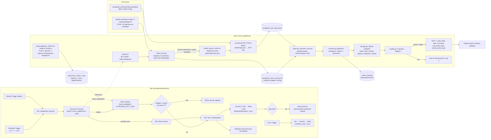

# Схема пайплайна

Конфигурация B: n8n отвечает за расписание, запуск и оповещения; сбор, очистка, качество и хранение — код.

## Сквозной поток одной записи

| Шаг | Где | Что происходит с репозиторием `owner/repo` |
|---|---|---|
| 1 | `collect_html.collect_topics` | карточка на странице темы → поля как есть + `rank_in_topic` → строка в `raw/github_topics_html.jsonl` с провенансом |
| 2 | `collect_api.select_keys` | ключ новый / дата «Updated» новее водяного знака / проверка старше 20 ч → в очередь API; иначе пропуск |
| 3 | `PoliteClient.get` | лимит домена → `If-None-Match` → 304 (только отметка `checked_at`) или 200 (минимизированный JSON в raw) |
| 4 | `clean.build_clean` | нормализация текста, ключ в нижнем регистре, типы и UTC, самая свежая версия, синоним при переименовании |
| 5 | `contract` | `TopicListing` / `RepoRecord`; нарушение → `clean/rejects.jsonl` с полем и причиной |
| 6 | `storage.load_all` | UPSERT по `repo_key`; `updated_at` меняется только при смене хэша бизнес-полей; снапшот дня |
| 7 | `quality.compute_quality` | метрики набора; красный статус блокирует mart |
| 8 | `storage.build_mart` | `v_repo_topic` (карточка ⋈ метрики API) → агрегаты по темам, размеру и активности |

## Состояние между прогонами

| Файл / таблица | Назначение |
|---|---|
| `state/watermark.json` | по каждому ключу: `checked_at`, `pushed_at`, `gh_updated_at`, код последнего ответа; глобальный `api_max_updated_at` |
| `state/etags.json` | ETag / Last-Modified по URL для условных запросов |
| `state/checkpoint.json` | незавершённый прогон: собранные страницы тем и обработанные ключи API (возобновление) |
| `pipeline_runs` (БД) | история прогонов: сравнение с прошлым, серия «без изменений», признак имитации по адресам источников |
