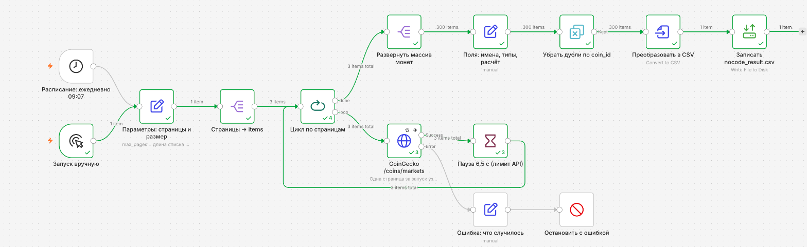
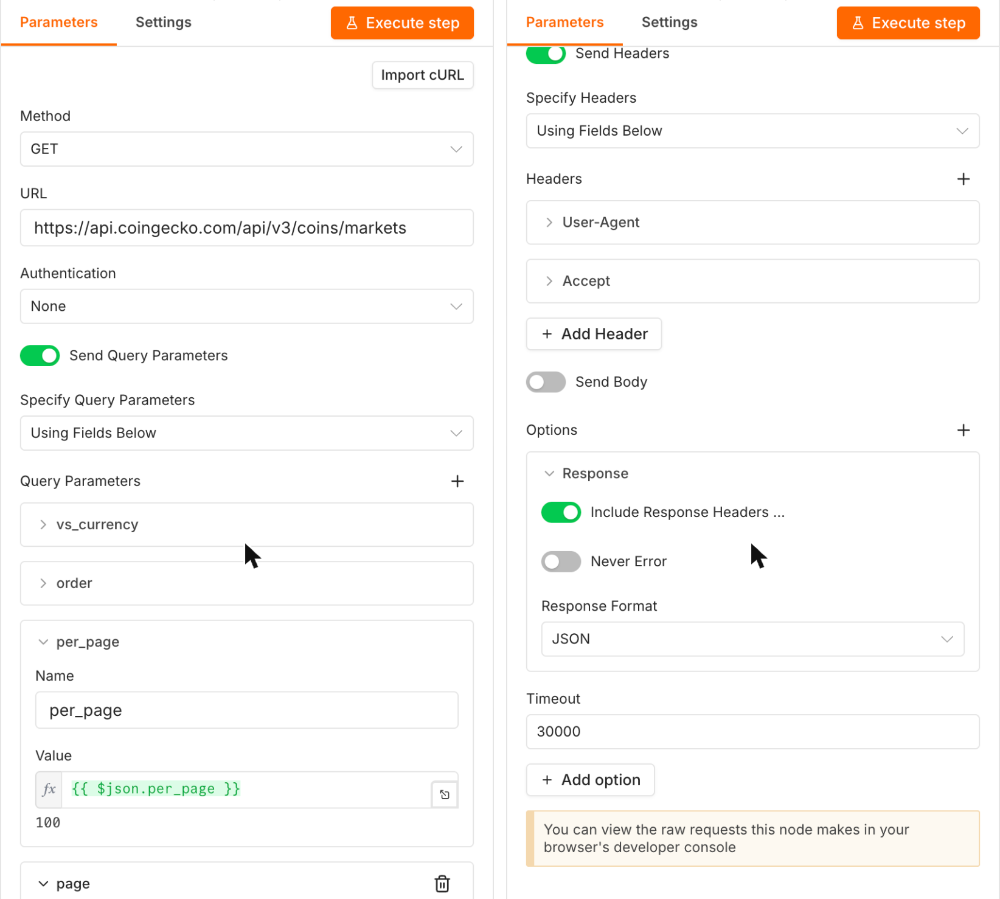
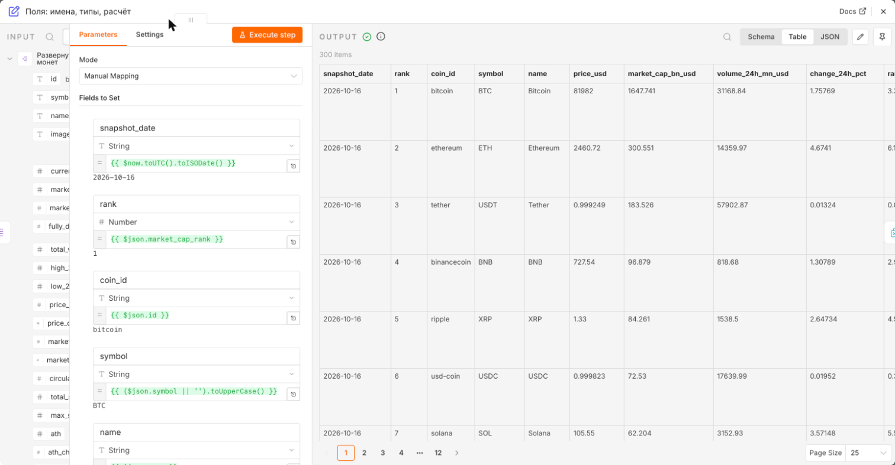

# Отчёт по лабораторной работе № 3 «Сбор данных через REST API: код и no-code»

**Студент:** Подольский Ф. А., группа ПМИ-3-2025. **Вариант 5 — CoinGecko.**
**Дата реального прогона:** ⟪ЗАПОЛНИТЬ после прогона⟫ (UTC). Данные — *Powered by CoinGecko*.

## 1. Цель и вариант

Цель — построить воспроизводимый сбор данных из REST API с пагинацией, ограничением скорости, повторами, нормализацией,
обогащением, контролем качества и инкрементальным обновлением, повторить основной сценарий в no-code инструменте (n8n)
и сравнить подходы.

Вариант 5: основной API — CoinGecko `GET /coins/markets` (пагинация `per_page`/`page`, жёсткий лимит частоты);
обогащение — `GET /coins/{id}/market_chart`. Аналитическая задача — капитализация и суточная волатильность топ-активов.
Собирается топ-400 монет по капитализации (4 страницы по 100), для топ-50 дополнительно — 30-дневная история.

## 2. Паспорт API

| Поле | Значение |
|---|---|
| Название, базовый URL | CoinGecko API (Public / Demo), `https://api.coingecko.com/api/v3` |
| Версия | `v3` в пути URL; справочник документации — v3.0.1 |
| Эндпоинты | `/ping` — проверка; `/coins/markets` — основной; `/coins/{id}/market_chart` — обогащение |
| Аутентификация | keyless или Demo-ключ в заголовке `x-cg-demo-api-key` (из `.env`, в выводе маскируется) |
| Тип пагинации | постраничная: `per_page` 1–250 (по умолчанию 100), `page` с 1; общее число записей и ссылка на следующую страницу не возвращаются |
| Лимиты | keyless — общий пул на IP, ≈10–30 запросов/мин в зависимости от нагрузки (в статье поддержки — 5–15/мин); Demo — 100/мин и 10 000 вызовов/мес по актуальной документации (ранее — 30/мин); превышение → 429; ответы 4xx/5xx тоже расходуют лимит; данные `/coins/markets` в бесплатных планах обновляются раз в 60 с |
| Заголовки лимитов | ⟪ЗАПОЛНИТЬ после прогона⟫ (вывод ячейки «Заголовки, нужные для паспорта API»); документация `X-RateLimit-*` и `Retry-After` не описывает |
| Формат дат | `/coins/markets` — ISO 8601 UTC (`last_updated`, `ath_date`, `atl_date`); `/market_chart` — Unix-время в мс, дневные точки на 00:00 UTC |
| Ключ уникальности | `id` монеты в снимке; в накопительной таблице — (`id`, `snapshot_date`); в `/market_chart` — (`coin_id`, `timestamp`) |
| Персональные данные | нет — рыночные показатели криптоактивов |
| Ограничения ToS | атрибуция «Powered by CoinGecko» (п. 4.3), запрет продажи и перераспределения доступа к API (п. 4.1.6), обновление кэша не реже раза в 24 ч (п. 6.1.1), удаление данных при прекращении доступа (п. 6.1.4, 10.4), право Сингапура (п. 13.1) |

## 3. Архитектура пайплайна

```
 ИСТОЧНИК          СБОР                       НОРМАЛИЗАЦИЯ                ПРОВЕРКА                ХРАНЕНИЕ
 CoinGecko API ─► Session + RateLimiter ─► json_normalize(sep="_")  ─► полнота, дубликаты, ─► data_raw.jsonl (сырьё)
 /coins/markets   request_json: повторы,   record_path sparkline        типы, правила R1–R7    data_clean.csv
 /market_chart    Retry-After, журнал      → σ за 7 дней                 → qc_flags             (ключ id + snapshot_date)
                  fetch_markets: 4 стр.    select_new (водяной знак)                            collection_log.csv
                                           enrich: market_chart топ-50                          state.json
                                           merge + проверка числа строк
```

1. **Сбор.** Одна `requests.Session` (User-Agent курса, `Accept: application/json`, таймаут `(5, 30)` в каждом запросе).
   Все запросы — через `request_json`: ограничитель скорости → запрос → `parse_json` (статус, `Content-Type`, JSON) →
   запись попытки в журнал.
2. **Нормализация.** `json_normalize(sep="_")` раскрывает объект `roi`; вложенный массив `sparkline_in_7d.price`
   разворачивается `json_normalize(record_path=["sparkline_in_7d", "price"], meta=["id"])` — ≈168 строк на монету, по ним
   считается σ почасовых лог-доходностей × √24. Даты → `datetime64[UTC]`, числа → `float64`, ранг → `Int64`.
   Дубликаты по `id` (монета на границе страниц) удаляются, остаётся запись с более поздним `last_updated`.
3. **Инкрементальный отбор** по водяному знаку `state.json` (дата снимка + id сохранённых монет) — до обогащения,
   чтобы не тратить запросы на уже сохранённые записи.
4. **Обогащение.** Для новых монет топ-50 — `/market_chart?days=30&interval=daily`: σ дневных лог-доходностей за 30 суток,
   изменение капитализации за 30 дней, средний объём. `merge(how="left", validate="one_to_one")`, число строк до и
   после сравнивается `assert`-ом. Итоговая `daily_volatility_pct` — 30-дневная оценка для топ-50, 7-дневная для
   остальных (источник в `vol_source`).
5. **Хранение.** Сырые данные дописываются в `data_raw.jsonl`; чистая таблица сливается со старыми строками без
   дубликатов ключа и пишется атомарно (временный файл + `os.replace`); `state.json` — тоже атомарно.

## 4. Решения по пагинации, лимитам и повторам

- **Пагинация.** `per_page=100`, `max_records=400`, `max_pages=5`. Номер следующей страницы считается из фактически
  полученного числа записей; остановка — пустая страница, неполная страница, `total` из заголовка (если сервер его
  пришлёт), `max_records`, `max_pages`. Страницы по 250 записей дали бы 400 записей за 2 запроса, но задание требует
  ≥ 3 страниц, а меньшая страница снижает потерю при сбое одного запроса.
- **Дрейф рейтинга.** Пока запрашиваются страницы, капитализации меняются, и монета с границы страниц может прийти
  дважды, а соседняя — ни разу. Дубликаты удаляются на этапе нормализации; в реальном прогоне удалено
  ⟪ЗАПОЛНИТЬ после прогона⟫ записей.
- **Лимит.** Пауза 6,5 с без ключа (≈9 запросов/мин — ниже нижней оценки keyless-лимита из документации) и 2,5 с
  с Demo-ключом. После каждого 429 интервал увеличивается в 1,5 раза (до 30 с).
- **Повторы.** Только 429, 500/502/503/504 и сетевые сбои; `Retry-After` учитывается (секунды или HTTP-дата, не больше
  120 с), без него — экспонента 3, 6, 12, 24, 48 с с «равным» джиттером (случайно от половины до полного значения);
  не больше 6 попыток. Остальные 4xx не повторяются: по документации ошибочные запросы тоже расходуют лимит.
- **Условные запросы (бонус).** `ETag` страницы сохраняется в `state.json`; при следующем запросе отправляется
  `If-None-Match`, ответ 304 → записи берутся из `data_raw.jsonl`.
- **Результат реального прогона:** HTTP-попыток ⟪ЗАПОЛНИТЬ⟫, повторов ⟪ЗАПОЛНИТЬ⟫, ответов 429 ⟪ЗАПОЛНИТЬ⟫,
  5xx ⟪ЗАПОЛНИТЬ⟫ (сводка этапа 8). Повторный прогон: новых строк ⟪ЗАПОЛНИТЬ⟫, запросов обогащения ⟪ЗАПОЛНИТЬ⟫ (этап 9).
- **Демонстрация 429 (этап 10):** ⟪ЗАПОЛНИТЬ после прогона: «429 получен на запросе № N, пауза X с по Retry-After /
  по backoff, повтор успешен» или «за 25 запросов 429 не возник, реакция показана на имитации»⟫.

## 5. Качество данных и результат анализа

Проверки — на сохранённом снимке ⟪ЗАПОЛНИТЬ: дата⟫, ⟪ЗАПОЛНИТЬ: N⟫ строк. Дубликатов по ключу (`id`, `snapshot_date`)
после дедупликации — ⟪ЗАПОЛНИТЬ⟫ (до — ⟪ЗАПОЛНИТЬ⟫). Даты имеют тип `datetime64[UTC]`, числовые поля — числовой тип.

**Полнота полей** (таблицу по всем полям печатает этап 12; ниже — поля, где ожидаются пропуски):

| Поле | Полнота, % | Почему может быть < 100 % |
|---|---|---|
| `id`, `name`, `current_price`, `market_cap`, `market_cap_rank`, `last_updated` | ⟪ЗАПОЛНИТЬ⟫ | — |
| `fully_diluted_valuation` | ⟪ЗАПОЛНИТЬ⟫ | нет данных об общей эмиссии |
| `total_supply` | ⟪ЗАПОЛНИТЬ⟫ | не раскрыта проектом |
| `max_supply` | ⟪ЗАПОЛНИТЬ⟫ | эмиссия не ограничена (ETH, стейблкоины и др.) |
| `roi_times`, `roi_currency`, `roi_percentage` | ⟪ЗАПОЛНИТЬ⟫ | ROI считается только для монет с ICO |
| `vol_7d_sparkline_pct` | ⟪ЗАПОЛНИТЬ⟫ | у новых монет меньше 2 суток истории |
| `vol_30d_daily_pct`, `mcap_change_30d_pct`, `avg_volume_30d` | ⟪ЗАПОЛНИТЬ⟫ | только топ-50 (≈12,5 % строк) по замыслу |
| `daily_volatility_pct` | ⟪ЗАПОЛНИТЬ⟫ | — |

**Правила бизнес-логики** (нарушение не удаляет строку, а пишется в `qc_flags`):

| Код | Правило | Проверено | Нарушений |
|---|---|---|---|
| R1 | `current_price > 0` | ⟪ЗАПОЛНИТЬ⟫ | ⟪ЗАПОЛНИТЬ⟫ |
| R2 | `market_cap ≥ 0`, `total_volume ≥ 0` | ⟪ЗАПОЛНИТЬ⟫ | ⟪ЗАПОЛНИТЬ⟫ |
| R3 | `low_24h ≤ current_price ≤ high_24h` (±1 %) | ⟪ЗАПОЛНИТЬ⟫ | ⟪ЗАПОЛНИТЬ⟫ |
| R4 | `circulating ≤ total ≤ max` (±0,1 %) | ⟪ЗАПОЛНИТЬ⟫ | ⟪ЗАПОЛНИТЬ⟫ |
| R5 | `market_cap ≈ price × circulating` (±5 %) | ⟪ЗАПОЛНИТЬ⟫ | ⟪ЗАПОЛНИТЬ⟫ |
| R6 | капитализация не растёт с рангом (±0,1 %) | ⟪ЗАПОЛНИТЬ⟫ | ⟪ЗАПОЛНИТЬ⟫ |
| R7 | `0 ≤ daily_volatility_pct < 100` | ⟪ЗАПОЛНИТЬ⟫ | ⟪ЗАПОЛНИТЬ⟫ |

Небольшое число нарушений R3 и R6 ожидаемо: цена, диапазон 24 ч и ранг обновляются у CoinGecko не одновременно.

**Капитализация и волатильность** (этап 11): суммарная капитализация топ-400 — ⟪ЗАПОЛНИТЬ⟫ трлн $; доля № 1 —
⟪ЗАПОЛНИТЬ⟫ %, топ-10 — ⟪ЗАПОЛНИТЬ⟫ %, индекс Херфиндаля — Хиршмана ⟪ЗАПОЛНИТЬ⟫. Медианная суточная σ по группам рангов:

⟪ЗАПОЛНИТЬ: таблица «группа по рангу» из этапа 11⟫

Ранговая корреляция «капитализация ↔ σ» — ⟪ЗАПОЛНИТЬ⟫; согласованность двух оценок σ на топ-50 (7 дней почасовых
против 30 дней дневных) — ⟪ЗАПОЛНИТЬ⟫. Монеты с σ < 0,5 % (стейблкоины): ⟪ЗАПОЛНИТЬ⟫.
Вывод: ⟪ЗАПОЛНИТЬ после прогона: 2–3 предложения по фактическим цифрам⟫.

## 6. No-code: n8n

Workflow `nocode/workflow.json` (n8n 2.x): Schedule Trigger (ежедневно 09:07, Asia/Yekaterinburg) и Manual Trigger →
**Edit Fields** (`page_list = [1, 2, 3]`, `per_page = 100`) → **Split Out** (страницы → items) → **Loop Over Items**
(по одной странице) → **HTTP Request** (GET `/coins/markets`; query `vs_currency`, `order`, `per_page`, `page`,
`price_change_percentage`; заголовки `User-Agent`, `Accept`; полный ответ; Retry On Fail — 3 попытки через 5 с;
On Error → ошибочный выход) → **Wait** 6,5 с → обратно в цикл. После последней страницы: **Split Out** (`body` → item на
монету) → **Edit Fields** (переименование `id → coin_id`, `current_price → price_usd` и др.; приведение к Number; дата
`last_updated` → ISO UTC; вычисляемые `range_24h_pct`, `market_cap_bn_usd`, `volume_24h_mn_usd`; атрибуция в `source`) →
**Remove Duplicates** по `coin_id` → **Convert to File** (CSV) → **Read/Write Files from Disk** (`nocode/nocode_result.csv`).
Ветка ошибки: второй выход HTTP Request → Edit Fields (время, страница, текст, код) → **Stop and Error**.

Проверка до сдачи (на локальной имитации API, n8n 2.43.6): workflow импортируется и выполняется — 3 страницы,
300 items → 299 строк CSV после удаления дубликата на границе страниц; сбой 503 на третьей странице снят повтором через
5 с; при неверном пути — три ответа 404 подряд, затем ветка ошибки и Stop and Error. Первая версия со встроенной
пагинацией HTTP Request при сбое на третьей странице отдала частичный результат (страницы 1–2) без повтора: n8n повторяет
узел, только если ошибкой оказался первый item выхода. Поэтому пагинация сделана циклом Loop Over Items + Wait — этот
вариант задание допускает наравне со встроенной пагинацией.

Реальный прогон: ⟪ЗАПОЛНИТЬ после прогона n8n: строк в `nocode_result.csv`, длительность из Executions⟫.





## 7. Сравнение Python и n8n

Значения Python — из `state.json` и `collection_log.csv` (готовую таблицу печатает этап 12), n8n — из Executions.

| Критерий | Python (requests + pandas) | n8n |
|---|---|---|
| Время разработки | ⟪ЗАПОЛНИТЬ⟫ ч | ⟪ЗАПОЛНИТЬ⟫ ч |
| Число записей | ⟪ЗАПОЛНИТЬ⟫ монет (+⟪ЗАПОЛНИТЬ⟫ обогащены `market_chart`) | ⟪ЗАПОЛНИТЬ⟫ |
| Время прогона | ⟪ЗАПОЛНИТЬ⟫ с — первый за день; ⟪ЗАПОЛНИТЬ⟫ с — повторный | ⟪ЗАПОЛНИТЬ⟫ с |
| Пагинация | `per_page`/`page`, 4 стр.; стоп по пустой/неполной странице, `max_records`, `max_pages` | Loop Over Items по списку страниц `[1, 2, 3]` + Wait 6,5 с; встроенная пагинация HTTP Request отвергнута — при сбое на середине частичный результат без повтора |
| Ошибки / повторы | только 429/5xx/сеть; `Retry-After` + экспонента с джиттером; 4xx без повторов; в прогоне: ⟪ЗАПОЛНИТЬ⟫ повторов | Retry On Fail: 3 попытки через фиксированные 5 с при любой ошибке (на имитации — и на 404), `Retry-After` не читается; ветка ошибки → Stop and Error |
| Воспроизводимость | `requirements.txt` + `run_real.sh`, код в Git, состояние в `state.json` | импорт `workflow.json`; зависит от версии n8n и переменных окружения при запуске |
| Стоимость при 100 прогонах/мес | ⟪ЗАПОЛНИТЬ⟫ вызовов API/мес (≈30 первых прогонов дня + 70 повторных); 0 ₽ | 3 вызова за прогон → 300 вызовов/мес; self-hosted — 0 ₽ |
| Порог входа (1–5) | 4 — нужны Python, pandas, HTTP | 2 — визуальная сборка, но выражения n8n и пагинацию всё равно надо понимать |

**Вывод о гибриде.** n8n удобен как оркестратор: расписание, выгрузка одного эндпоинта и уведомление об ошибке
собираются быстро и понятны без кода. Но при жёстком лимите его повторы грубые (повтор даже на 404, фиксированная
пауза, `Retry-After` не учитывается, при встроенной пагинации сбой на середине не повторяется), а инкрементальность, обогащение 50 монет и проверки качества превращаются в цепочки
Code-узлов, которые хуже тестировать и версионировать. Рациональный гибрид: n8n по расписанию запускает Python-сбор
(Execute Command или HTTP-вызов сервиса) и обрабатывает исход — уведомление, выкладку CSV, — а логика сбора, повторов,
нормализации и качества остаётся в Python, где она покрыта журналом и воспроизводится одной командой.
⟪ЗАПОЛНИТЬ после прогона: подтвердить или скорректировать вывод по измеренному времени разработки и прогона⟫.

## 8. Правовая оценка

- **Условия использования.** Сбор идёт через официальный API CoinGecko на условиях API Terms of Service
  (Gecko Labs Pte. Ltd., право Сингапура): в пределах лимитов бесплатного тарифа, без обхода ограничений (одна сессия,
  один IP, без ротации ключей и адресов), с честным User-Agent. Атрибуция «Powered by CoinGecko» есть в блокноте,
  отчёте и в столбце `source` результата n8n (п. 4.3). Доступ к API и данные не продаются и не перераспределяются
  (п. 4.1.6); HTML-страницы сайта не парсятся.
- **Хранение и кэш.** Условия не поощряют хранение данных и требуют обновлять кэш не реже раза в 24 ч (п. 6.1.1). Здесь
  данные — датированные снимки (`snapshot_date`) для разового учебного анализа, они не выдаются как текущие котировки.
  В открытый репозиторий их стоит выкладывать только с атрибуцией и в объёме, нужном для проверки; полный сырой массив
  лучше передать преподавателю отдельно. При прекращении доступа к API данные удаляются (п. 6.1.4, 10.4).
- **Персональные данные.** Не собираются: только агрегированные рыночные показатели криптоактивов (цены, капитализация,
  объёмы, эмиссия). Сведений о физических лицах в ответах нет; User-Agent содержит ссылку на собственный репозиторий
  автора, а IP-адрес клиента обрабатывает CoinGecko по своей политике.
- **152-ФЗ.** Поскольку персональные данные не обрабатываются, правовое основание по ст. 6, согласие субъектов и
  уведомление Роскомнадзора не требуются. Если бы в набор попали ПДн (например, сведения об авторах проектов),
  понадобились бы основание по ст. 6 (для учебной работы — согласие или обезличивание) и минимизация полей.
- **База данных.** Массив котировок CoinGecko может охраняться как база данных (ст. 1334 ГК РФ); извлечение правомерно,
  поскольку выполняется по лицензии — на условиях API Terms — и в небольшом объёме.
- **Срок хранения.** `data_raw.jsonl` и `collection_log.csv` — до проверки работы, не дольше конца семестра;
  `data_clean.csv` — на время курса; затем удаление. `.env` с ключом в репозиторий не попадает (`.gitignore`).

## 9. Источники

1. CoinGecko API — Coins List with Market Data (`/coins/markets`): https://docs.coingecko.com/demo/reference/coins-markets
2. CoinGecko API — Coin Historical Chart Data by ID (`/coins/{id}/market_chart`): https://docs.coingecko.com/demo/reference/coins-id-market-chart
3. CoinGecko — Error Codes and Rate Limits: https://docs.coingecko.com/docs/errors-and-rate-limits
4. CoinGecko — Keyless Public API: https://docs.coingecko.com/docs/keyless-public-api
5. CoinGecko — API Plans & Pricing: https://www.coingecko.com/en/api/pricing
6. CoinGecko — API Terms of Service: https://www.coingecko.com/en/api_terms
7. CoinGecko — Attribution Guide: https://brand.coingecko.com/resources/attribution-guide
8. CoinGecko Support — Why am I getting errors with a status code 429: https://support.coingecko.com/hc/en-us/articles/4538787440153-Why-am-I-getting-errors-with-a-status-code-429
9. pandas — `json_normalize`: https://pandas.pydata.org/docs/reference/api/pandas.json_normalize.html
10. Requests — Advanced Usage (Session, Timeouts, Transport Adapters): https://requests.readthedocs.io/en/latest/user/advanced/
11. RFC 9110 HTTP Semantics — `Retry-After`, `ETag`, `If-None-Match`: https://www.rfc-editor.org/rfc/rfc9110
12. RFC 6585 — 429 Too Many Requests: https://www.rfc-editor.org/rfc/rfc6585#section-4
13. AWS Architecture Blog — Exponential Backoff and Jitter: https://aws.amazon.com/blogs/architecture/exponential-backoff-and-jitter/
14. n8n — HTTP Request node (pagination): https://docs.n8n.io/integrations/builtin/core-nodes/n8n-nodes-base.httprequest/
15. n8n — Security environment variables (`N8N_RESTRICT_FILE_ACCESS_TO`, `N8N_BLOCK_ENV_ACCESS_IN_NODE`): https://docs.n8n.io/hosting/configuration/environment-variables/security/
16. Федеральный закон от 27.07.2006 № 152-ФЗ «О персональных данных»: https://www.consultant.ru/document/cons_doc_LAW_61801/
17. Гражданский кодекс РФ, часть четвёртая (ст. 1334 — право изготовителя базы данных): https://www.consultant.ru/document/cons_doc_LAW_64629/
18. Демонстрационный блокнот занятия 3 «REST API и JSON» (материалы курса).
