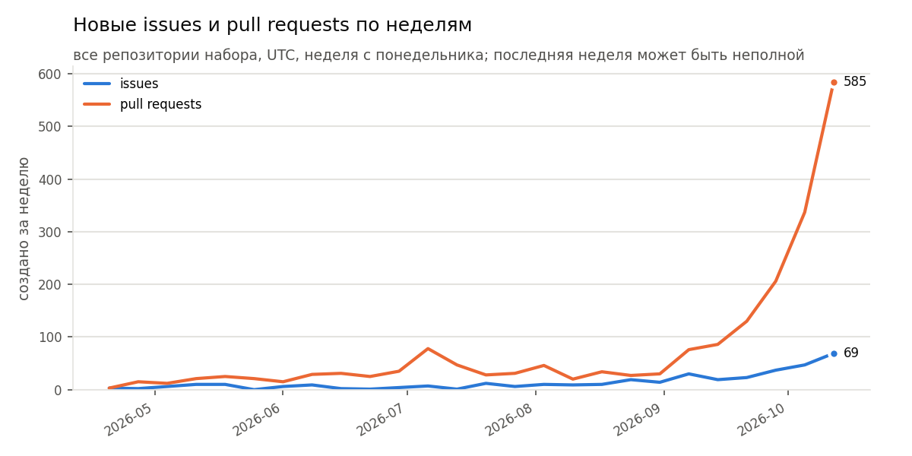
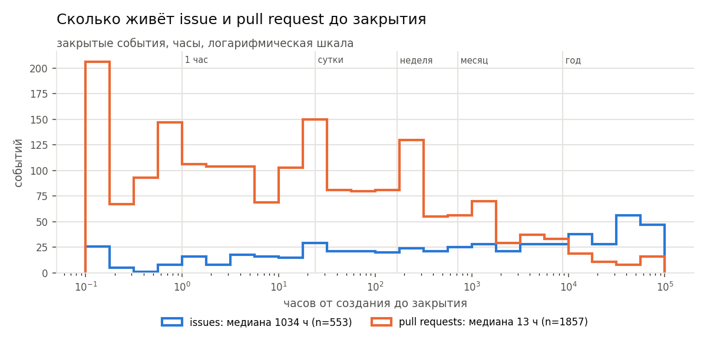
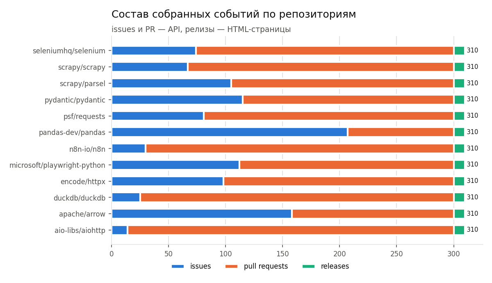

# Отчёт по лабораторной работе № 6 «Хранение, очистка и структурирование собранных данных»

**Студент:** Подольский Ф. А., ПМИ-3-2025 · **Вариант 5:** «Репозитории и активность» — API (репозитории, issues) + HTML-страница проекта; целевая схема — репозиторий и события, связь «один ко многим», даты в UTC.

> Цифры в блоках между отметками `AUTO` подставляет `python -m src.fill_report` из артефактов реального прогона (`run_real.sh` делает это сам). До прогона на их месте стоит маркер «ЗАПОЛНИТЬ после прогона».

## 1. Цель и вариант

Построить для данных о репозиториях GitHub трёхслойное хранилище raw → clean → mart, очистку в шесть шагов с протоколом, контракт pydantic, идемпотентную загрузку в SQLite с историей SCD2, метрики качества со «светофором» и no-code-загрузку в n8n.

<!-- AUTO:counts -->
Сырой слой: **4148** строк, из них синтетически испорченных **272** (7.0 % от числа реальных записей). Чистый слой: **3720** событий (issues — 1086, pull requests — 2514, релизы — 120) по **12** репозиториям; в rejects — **140** записей.
<!-- /AUTO:counts -->

## 2. Источники и их различия

Набор — 12 репозиториев инструментов этого курса (`config/repos.txt`): Scrapy и parsel (лаб. 5), requests, httpx, aiohttp (лаб. 1–3, 7), Playwright и Selenium (лаб. 4), n8n (no-code), pandas, pydantic, Arrow и DuckDB (эта работа). Предметная область прямо связана с курсом, а данные публичны и не требуют входа. Исходных наборов прошлых лабораторных для этого варианта не было (в лаб. 1 сохранялись только репозитории пользователя, без событий), поэтому данные собраны повторно средствами лаб. 1 (`requests` + GitHub API) и лаб. 2 (`BeautifulSoup`), как разрешает раздел 2 задания.

| | Источник 1 — GitHub REST API | Источник 2 — HTML github.com |
|---|---|---|
| Природа | JSON, документированный контракт (версия `2022-11-28`) | HTML-разметка для людей, контракта нет |
| Что берём | `/repos/{o}/{r}` — карточка; `/repos/{o}/{r}/issues?state=all` — issues и PR | `/{o}/{r}` — About: описание, сайт, темы, лицензия, звёзды, форки, наблюдатели (встроенный JSON страницы); `/{o}/{r}/releases` — релизы |
| Сущности | репозиторий, issue, pull request | страница репозитория, релиз |
| Формат значений | числа — числами, даты — ISO 8601 UTC с `Z` | текст: «54.3k», «53,912», «Python 99.8%», дата в атрибуте `datetime` |
| Пагинация | заголовок `Link: <…>; rel="next"`, `per_page=100` | `?page=N`, ссылка `a.next_page` |
| Ограничения | 60 запросов/ч без токена, 5000 с токеном; `X-RateLimit-*` | `robots.txt`: разрешены `/{o}/{r}` и `/releases`; запрещены `/contributors`, `/stargazers`, `/network`, `/tree/`, `?tab=` и др. |
| Особенность | `/issues` возвращает и PR — они маркируются (`event_type = pull_request`) | релизы с метками «Latest»/«Pre-release» и коротким SHA есть только здесь; счётчики страницы сверяются с API (правило R-05) |

Сбор: `python -m src.collect` — пауза 1 с между запросами к API и 3 с между страницами, User-Agent `PSU-edu-crawler/1.0 (+https://github.com/Meta1rus/web-data-extraction; student lab)`. robots.txt проверяется двумя разборщиками. robots.txt GitHub почти целиком состоит из шаблонов `*`/`$`, а стандартный `urllib.robotparser` обрабатывает их по-разному в зависимости от версии Python: в 3.11 шаблоны не поддерживаются вовсе, в 3.13.16 поддерживаются, но адрес с `?tab=` всё равно считается разрешённым. Поэтому добавлен собственный разбор по RFC 9309, и адрес разрешён, только если его разрешают оба разборщика.

**Результат первого реального прогона (15.10.2026): страница репозитория стала React-приложением.** Селекторы, составленные по прежней вёрстке (`#repo-stars-counter-star`, ячейки `.BorderGrid-cell` с `.Counter`), на живой странице ничего не нашли: в исходном HTML боковая панель — заглушки `SkeletonText`, а значения About лежат во встроенном JSON `<script type="application/json" data-target="react-app.embeddedData">` по пути `payload.sidebarAbout` (`description`, `website`, `topics`, `stargazerCount`, `forksCount`, `watcherCount`, `repo.license`). Это вариант «данные в разметке» из занятия 4: браузер не нужен, достаточно `json.loads`. Парсер дополнен этим путём (`_embedded_about` в `src/parsers.py`, версия `github-html/1.1`), после чего сохранённые страницы были **перепарсены без обращения к сайту** (`python -m src.reparse_html`) — ровно тот сценарий, ради которого raw хранит HTML. Блоки «Languages», «Used by», «Contributors» и число релизов в исходный HTML не попадают вовсе: React подгружает их отдельными запросами уже в браузере. Эти поля честно остаются NULL (это видно в полноте M2), а релизы берутся со страницы `/releases`, где разметка серверная и парсер сработал с первого раза. Звёзды со страницы совпали с API у всех 12 репозиториев (правило R-05 — 0 нарушений).

<!-- AUTO:collect -->
| показатель | значение |
|---|---|
| запуск (run_id) | 20261015T210737Z + 20261015T210922Z |
| длительность сбора, с | 192.8 |
| API: запросов / байт | 49 / 21522477 |
| API: коды ответов | {"200": 49} |
| API: остаток лимита до / после | 4999 / 4951 |
| HTML: запросов / байт | 25 / 11178029 |
| HTML: коды ответов | {"200": 25} |
| robots.txt: статус / запрещённых запросов отправлено | 200 / 0 |

Проверка robots.txt (фрагмент `logs/robots_decisions_20261015T210922Z.json`):

| путь | назначение | RFC 9309 | urllib.robotparser | итог | правило |
|---|---|---|---|---|---|
| /scrapy/scrapy | repo_page | можно | можно | можно | ни одно правило не совпало |
| /scrapy/scrapy/releases | release | можно | можно | можно | ни одно правило не совпало |
| /scrapy/scrapy/contributors | контроль (не запрашивается) | нельзя | можно | нельзя | Disallow: /*/*/contributors (urllib.robotparser считает: можно — расхождение) |
| /scrapy/scrapy/stargazers | контроль (не запрашивается) | нельзя | можно | нельзя | Disallow: /*/*/stargazers (urllib.robotparser считает: можно — расхождение) |
| /scrapy/scrapy/network/dependents | контроль (не запрашивается) | нельзя | можно | нельзя | Disallow: /*/*/network (urllib.robotparser считает: можно — расхождение) |
| /scrapy/scrapy/tree/main | контроль (не запрашивается) | нельзя | можно | нельзя | Disallow: /*/tree/ (urllib.robotparser считает: можно — расхождение) |
| /scrapy/scrapy?tab=readme-ov-file | контроль (не запрашивается) | нельзя | можно | нельзя | Disallow: /*?tab=* (urllib.robotparser считает: можно — расхождение) |
<!-- /AUTO:collect -->

## 3. Трёхслойное хранилище

```
raw/  (JSON Lines, только дозапись, 0444 + MANIFEST.jsonl с SHA-256)
  github_api.jsonl        _entity = repo | issue
  github_html.jsonl       _entity = repo_page | release   (+ raw/html/<run_id>/*.html.gz)
  synthetic_dirty.jsonl   синтетическая порча, _synthetic = true
        │  src/clean.py: 6 шагов + контракт; src/rebuild.py — та же сборка без сети
        ▼
clean/  dataset.parquet (события) · repositories.parquet · rejects.jsonl · cleaning_log.csv · format_benchmark.csv
        │  db/load.py: UPSERT + SCD2 → db/warehouse.db
        ▼
mart/   views/*.parquet (из SQL-представлений) · snapshots/dt=YYYY-MM-DD/ · charts/*.png
        ▲  только если src/quality.py не дал красный статус
```

У каждой строки raw есть поля происхождения `_source`, `_source_url`, `_collected_at` (UTC, ISO 8601), `_parser_version`, `_status`, а также `_entity` и `_run_id`. HTML-поля хранятся строкой «как на странице» (`stars_raw = "54.3k"`, `stars_title_raw = "54,312"`, `used_by_raw`, `languages_raw = ["Python 99.8%", …]`, `datetime_raw`). Числа из них получает только шаг 3 очистки. Неизменяемость обеспечена тем, что файлы открываются только в режиме `"a"`, после каждой дозаписи в `raw/MANIFEST.jsonl` пишется размер и SHA-256 файла, а `rawio.verify_all()` перед сбором и пересборкой сверяет хэш префикса. Правка уже записанной строки приводит к `RawTamperedError`.

**Пересборка clean из raw без обращения к сайту.** `python -m src.rebuild --verify` снимает отпечаток clean, удаляет его, запрещает сеть на уровне `socket.connect` и строит clean заново из raw, после чего сравнивает отпечатки. `clean.build()` детерминирована: она не использует ни текущее время, ни сеть (все сравнения во времени идут относительно `_collected_at`). Если поменялось правило разбора (например, «1.2m»), достаточно исправить `src/parsers.py`/`src/clean.py` и выполнить пересборку.

<!-- AUTO:raw -->
| файл | строк | размер, КБ | сущности | дозаписей в MANIFEST | неизменность |
|---|---|---|---|---|---|
| raw/github_api.jsonl | 3612 | 3704.1 | issue: 3600, repo: 12 | 12 | подтверждена |
| raw/github_html.jsonl | 264 | 192.3 | release: 240, repo_page: 24 | 13 | подтверждена |
| raw/synthetic_dirty.jsonl | 272 | 290.3 | issue: 252, release: 17, repo_page: 2, repo: 1 | 2 | подтверждена |

Типы синтетической порчи (`_corruption`): full_duplicate — 55, tracking_url — 35, nbsp_zero_width — 35, closed_without_closed_at — 22, created_in_future — 18, negative_comments — 17, orphan_repo — 16, bad_date — 14, closed_before_created — 13, merged_issue — 13, bad_label_color — 11, case_slug — 7, missing_title — 6, naive_date — 6, missing_datetime — 3, missing_id — 1
<!-- /AUTO:raw -->

<!-- AUTO:rebuild -->
| набор | строк до | SHA-256 до | строк после | SHA-256 после |
|---|---|---|---|---|
| events | 3720 | b332a42c69575fc7 | 3720 | b332a42c69575fc7 |
| repositories | 12 | fcbea1d821908836 | 12 | fcbea1d821908836 |
| rejects | 140 | 6b9408b96290871b | 140 | 6b9408b96290871b |

Пересборка без сети заняла 0.99 с; результат идентичен: **да**.
<!-- /AUTO:rebuild -->

**Синтетическая порча (помечена).** `python -m src.corrupt --share 0.07` дописывает в отдельный файл `raw/synthetic_dirty.jsonl` порченые записи (по 7 % записей каждой сущности в каждой партии сбора). Каждая помечена `_synthetic: true` и `_corruption: <тип>`. Типы: неразрывные и zero-width пробелы, `utm_*` в URL, другой регистр slug, полный дубль, пустой заголовок, нераспознаваемая и наивная дата, закрытие без `closed_at`, `closed_at < created_at`, отрицательные комментарии, дата из будущего, `merged_at` у issue, событие несуществующего репозитория, цвет метки не в hex, кириллическая «к» в «54.3к». Порченые копии получают `_collected_at` на час раньше оригинала, а «битые» записи — несуществующий номер, поэтому в чистый слой не попадает ни одно синтетическое значение.

## 4. Сравнение форматов

<!-- AUTO:formats -->
| показатель | CSV | JSON Lines | JSON Lines + gzip | Parquet (zstd) |
|---|---|---|---|---|
| строк | 3720 | 3720 | 3720 | 3720 |
| размер, КБ | 1824.1 | 3160.1 | 279.8 | 283.8 |
| чтение всего, мс | 11.8 | 34.2 | 38.3 | 3.3 |
| чтение 3 столбцов, мс | 5.7 | 34.4 | 38.5 | 1.1 |
| тип created_at | object | datetime64[ns, UTC] | datetime64[ns, UTC] | datetime64[ns, UTC] |
| тип label_color | object | object | object | object |
| label_color «033166» → | '033166' | '033166' | '033166' | '033166' |
| commit_sha «0c5e5e1» → | '0c5e5e1' | '0c5e5e1' | '0c5e5e1' | '0c5e5e1' |
| тип comments (Int64 с пропусками) | float64 | float64 | float64 | Int64 |
| тип labels (список) | str | list | list | ndarray |

Набор: 3720 строк (clean/dataset.parquet), время — медиана из 7 повторов, pandas 2.3.3. Parquet меньше CSV в **6.4** раза. Ловушка CSV: в партии из 36 строк, где все цвета меток — цифры, `033166` после записи в CSV и чтения стало `33166` (тип int64); спасает только явный `dtype=str` → '033166'.
<!-- /AUTO:formats -->

**Вывод.** CSV теряет типы. Дата UTC возвращается строкой, целые с пропусками становятся `float64`, списки меток — строкой `"['bug']"`. Строковое поле с ведущими нулями (`label_color = "008672"` — стандартный цвет метки «help wanted», короткий SHA вида `"0f3d…"`) сохраняется только пока в столбце есть буквы: на партии из одних цифр `read_csv` выводит `int64` и превращает `"008672"` в `8672`, то есть результат зависит от содержимого партии. JSON Lines сохраняет строки и списки, а даты восстанавливает лишь потому, что столбцы названы `*_at`. Целые с пропусками он тоже отдаёт как `float64`, а без сжатия обычно крупнее CSV: имена полей повторяются в каждой строке. Parquet единственный вернул все типы (`datetime64[…, UTC]`, `Int64`, списки), он в разы меньше CSV (точное отношение — в таблице) и читает выбранные столбцы, не разбирая файл целиком. Отсюда распределение по слоям:
- **raw** — JSON Lines, потому что формат допускает дозапись, переносит разнородные записи и повреждение строки не задевает соседние;
- **clean и mart** — Parquet (zstd), потому что важны типы, размер и колоночное чтение;
- **CSV** — только для передачи людям (`nocode_result.csv`, `format_benchmark.csv`).

## 5. Протокол очистки

Порядок фиксирован (`src/clean.py`). Шаг 0 — чтение raw, шаг 7 — контракт pydantic.

1. **Нормализация текста.** NFKC, `\xa0`, zero-width, схлопывание пробелов, обрезка, пустое → NULL (заголовки, описания, все `*_raw`, метки).
2. **Бизнес-ключ.** `repo_key = owner/name` в нижнем регистре из `full_name` / `repository_url` / адреса страницы. `event_key = repo_key#номер` для issue/PR и `repo_key@тег` для релиза. URL проходят `canonical_url()` (удаляются `utm_*`, `ref`, `fbclid`, фрагмент и завершающий `/`) и хранятся отдельно — первичным ключом они не служат.
3. **Типизация.** Целые со страницы («54.3k», «1.6m», «53,912», «5,000+») превращаются в `Int64`, причём точное значение из атрибута `title` предпочтительнее округлённого. Флаги приводятся к `boolean`, даты — к `datetime64[…, UTC]`. Наивная дата не считается UTC: она остаётся пустой с причиной «дата без часового пояса». Денежных полей в варианте нет.
4. **Пропуски.** Обязательные поля (ключи, тип, заголовок, состояние, `created_at`, время и адрес сбора) отбраковываются с причиной. Необязательные остаются NULL, ничего не заполняется средним.
5. **Дубликаты.** Полные (одинаковый raw без меток синтетики), по ключу (оставляется самая свежая по `updated_at`, затем `_collected_at`) и почти-дубли (совпадают только после шагов 1–2). Карточки API и HTML одного `repo_key` сливаются в одну запись. «Похожие» события с одинаковым заголовком только подсчитываются: это разные объекты GitHub.
6. **Бизнес-правила.** Для репозиториев 6 правил (R-01…R-06), для событий 8 (E-01…E-08), список ниже. При расхождении HTML и API (R-04, R-05, R-06) отбраковывается только HTML-часть, данные API сохраняются.

<!-- AUTO:cleaning -->
| шаг | сущность | строк до | строк после | изменено | удалено | в rejects | примечание |
|---|---|---|---|---|---|---|---|
| 0. чтение raw | repos_api | 13 | 13 | 0 | 0 | 0 | из них синтетических: 1 |
| 0. чтение raw | repos_html | 26 | 26 | 0 | 0 | 0 | из них синтетических: 2 |
| 0. чтение raw | events | 4109 | 4109 | 0 | 0 | 0 | из них синтетических: 269 |
| 1. нормализация текста | repos_api | 13 | 13 | 1 | 0 | 0 | исправлено значений — homepage: 1 |
| 1. нормализация текста | repos_html | 26 | 26 | 0 | 0 | 0 | исправлено значений — нет |
| 1. нормализация текста | events | 4109 | 4109 | 116 | 0 | 0 | исправлено значений — title: 116 |
| 2. бизнес-ключ | repos_api | 13 | 13 | 0 | 0 | 0 | repo_key построен: 13, не построен: 0 |
| 2. бизнес-ключ | repos_html | 26 | 26 | 2 | 0 | 0 | repo_key построен: 26; URL очищено от трекинга: 2 |
| 2. бизнес-ключ | events | 4109 | 4109 | 33 | 0 | 0 | event_key построен: 4109, не построен: 0; URL с трекингом нормализовано: 33 |
| 3. типизация | repos_api | 13 | 13 | 0 | 0 | 0 | целые: 6 полей → Int64; даты → UTC; ошибок приведения: 0 |
| 3. типизация | repos_html | 26 | 26 | 0 | 0 | 0 | «54.3k»/«53,912» → Int64 (точное значение из title, если есть); не распознано значений: 0 |
| 3. типизация | events | 4109 | 4109 | 20 | 0 | 0 | даты → datetime UTC; не разобрано дат: 20 (из них наивных: 6); целые → Int64, ошибок: 0; PR из /issues промаркированы: 2682 |
| 4. пропуски | repos_api | 13 | 12 | 0 | 1 | 1 | обязательные → rejects; необязательные остаются NULL (полнота: description 100.0%, homepage 91.7%, language 100.0%, license_spdx 100.0%, watchers 100.0%, pushed_at_t 100.0%) |
| 4. пропуски | repos_html | 26 | 26 | 0 | 0 | 0 | обязательные → rejects; необязательные остаются NULL (полнота: releases_count 0.0%, latest_release_tag_raw 0.0%, used_by 0.0%, contributors 0.0%, primary_language_pct 0.0%, stars_html 46.2%) |
| 4. пропуски | events | 4109 | 4080 | 0 | 29 | 29 | обязательные → rejects; необязательные остаются NULL (полнота: labels_t 59.8%, label_color 59.8%, comments_t 93.8%, author_association 93.8%, gh_updated_at 93.8%, commit_sha 6.2%) |
| 5. дубликаты | repos_api | 12 | 12 | 0 | 0 | 0 | полных дублей: 0; почти-дублей (совпали после шагов 1–2): 0; повторных наблюдений: 0; устаревших версий: 0; оставлена самая свежая запись |
| 5. дубликаты | repos_html | 26 | 12 | 0 | 14 | 0 | полных дублей: 0; почти-дублей (совпали после шагов 1–2): 0; повторных наблюдений: 0; устаревших версий: 14; оставлена самая свежая запись |
| 5. дубликаты | events | 4080 | 3830 | 75 | 250 | 0 | полных дублей: 55; почти-дублей (совпали после шагов 1–2): 75; повторных наблюдений: 120; устаревших версий: 0; оставлена самая свежая запись; похожих событий (тот же заголовок и минута создания, разные номера): 143 — не удалялись, это разные объекты GitHub |
| 5. дубликаты | repositories (API ⨝ HTML) | 24 | 12 | 12 | 12 | 0 | карточки API и HTML одного repo_key объединены в одну запись: 12; только API: 0; только HTML: 0 (проверяются правилом R-01) |
| 6. бизнес-правила | repositories | 12 | 12 | 0 | 0 | 0 | правил: 6; отбраковано репозиториев: 0; отброшено HTML-частей при расхождении с API: 0 |
| 6. бизнес-правила | events | 3830 | 3731 | 0 | 99 | 99 | правил: 8; отбраковано событий: 99 |
| 7. контракт pydantic | repositories | 12 | 12 | 0 | 0 | 0 | модель Repository |
| 7. контракт pydantic | events | 3731 | 3720 | 0 | 11 | 11 | модель Event |
<!-- /AUTO:cleaning -->

<!-- AUTO:rules -->
| сущность | правило | нарушений | доля, % |
|---|---|---|---|
| repository | R-01 репозиторий подтверждён API (есть карточка /repos) | 0 | 0 |
| repository | R-02 счётчики API ≥ 0 (stars, forks, watchers, open issues) | 0 | 0 |
| repository | R-03 created_at ≤ pushed_at и ≤ момента сбора | 0 | 0 |
| repository | R-04 id репозитория на странице = id в API | 0 | 0 |
| repository | R-05 звёзды на странице ≈ звёзды в API (±2 % или погрешность «k») | 0 | 0 |
| repository | R-06 счётчики HTML ≥ 0, доля языка 0–100 % | 0 | 0 |
| event | E-01 событие не из будущего (created_at ≤ момента сбора) | 18 | 0.47 |
| event | E-02 closed_at ≥ created_at | 27 | 0.7 |
| event | E-03 state=closed ⇔ задан closed_at (issue/PR) | 22 | 0.57 |
| event | E-04 merged_at только у PR, не раньше создания и только у закрытого | 20 | 0.52 |
| event | E-05 число комментариев ≥ 0 | 17 | 0.44 |
| event | E-06 updated_at ≥ created_at | 0 | 0 |
| event | E-07 релиз: есть тег и нет номера; issue/PR: есть номер | 0 | 0 |
| event | E-08 репозиторий события есть в справочнике (ссылочная целостность) | 16 | 0.42 |
<!-- /AUTO:rules -->

## 6. Контракт данных

`src/contract.py` содержит две модели pydantic v2 с `extra="forbid"`. В **Repository** заданы ограничения `github_id > 0`, `stars/forks ≥ 0`, `primary_language_pct ∈ [0, 100]`, `owner` длиной 1–39 и др. В **Event** — `title` длиной 1–1024, `comments ∈ [0, 100 000]`, `label_color` по шаблону `^[0-9a-f]{6}$`, `commit_sha` по шаблону `^[0-9a-f]{7,40}$`, а `event_type`/`state`/`author_association` ограничены `Literal`.

Собственные `field_validator`:
1. `normalize_title` — NFKC без невидимых символов, затем проверяется `min_length`;
2. `utc_only` — наивная дата запрещена, осведомлённая приводится к UTC;
3. `clean_url` — только http(s) и без параметров трекинга;
4. `slug_key` — `repo_key` имеет вид `owner/name` в нижнем регистре.

`model_validator` проверяет согласованность полей:
- `event_key` соответствует `repo_key#number` или `repo_key@tag`;
- у релиза есть тег и нет номера;
- `closed` ⇔ задан `closed_at`;
- `closed_at ≥ created_at`;
- `merged_at` бывает только у PR;
- событие не создано позже момента сбора.

Для Repository дополнительно сверяется `repo_key = owner/name`, а HTML-поля допускаются только при `source = github_api+github_html`. Невалидная запись попадает в `rejects` с полем и текстом ошибки.

<!-- AUTO:contract -->
| модель | проверка | результат | поле | сообщение |
|---|---|---|---|---|
| Event | отрицательное число комментариев | отклонена | comments | Input should be greater than or equal to 0 |
| Event | пустой заголовок (пробелы и zero-width) | отклонена | title | String should have at least 1 character |
| Event | наивная дата без часового пояса | отклонена | created_at | дата без часового пояса (наивная) — источник времени неизвестен |
| Event | state=closed без closed_at | отклонена | <запись> | state='closed' должен сопровождаться closed_at, а open — его отсутствием |
| Event | closed_at раньше created_at | отклонена | <запись> | closed_at раньше created_at |
| Event | merged_at у issue (не PR) | отклонена | <запись> | merged_at допустим только у pull request |
| Event | event_key не равен repo_key#number | отклонена | <запись> | event_key issue/PR должен быть repo_key#number |
| Event | цвет метки не hex-6 | отклонена | label_color | String should match pattern '^[0-9a-f]{6}$' |
| Event | repo_key не в виде owner/name | отклонена | repo_key | repo_key должен иметь вид owner/name в нижнем регистре |
| Event | неизвестный тип события | отклонена | event_type | Input should be 'issue', 'pull_request' or 'release' |
| Event | событие из будущего | отклонена | <запись> | событие создано позже момента сбора (дата из будущего) |
| Event | URL с параметрами трекинга | отклонена | url | URL содержит параметры трекинга — должен быть нормализован |
| Repository | отрицательное число звёзд | отклонена | stars | Input should be greater than or equal to 0 |
| Repository | доля основного языка 120 % | отклонена | primary_language_pct | Input should be less than or equal to 100 |
| Repository | github_id = 0 | отклонена | github_id | Input should be greater than 0 |
<!-- /AUTO:contract -->

Распределение отбраковки по этапам и причинам:

<!-- AUTO:rejects -->
| этап | поле/правило | сущность | записей | из них синтетических |
|---|---|---|---|---|
| 4. пропуски | created_at | event | 23 | 23 |
| 4. пропуски | id | repository | 1 | 1 |
| 4. пропуски | title | event | 6 | 6 |
| 6. бизнес-правила | E-01 | event | 18 | 18 |
| 6. бизнес-правила | E-02 | event | 13 | 13 |
| 6. бизнес-правила | E-03 | event | 22 | 22 |
| 6. бизнес-правила | E-04 | event | 13 | 13 |
| 6. бизнес-правила | E-05 | event | 17 | 17 |
| 6. бизнес-правила | E-08 | event | 16 | 16 |
| 7. контракт | label_color | event | 11 | 11 |

Всего в rejects: 140; из них реальных (не синтетических) записей: **0**. Каждая запись хранит исходный payload, этап, поле и причину (`clean/rejects.jsonl`, таблица `rejects` в БД).
<!-- /AUTO:rejects -->

## 7. Схема БД

SQLite, `db/schema.sql`. Связь `repositories (1) → events (N)` задаётся внешним ключом `events.repo_key → repositories.repo_key` при `PRAGMA foreign_keys = ON`.

- **Ключи.** Первичный ключ — бизнес-ключ: `repositories.repo_key = owner/name`, `events.event_key = owner/name#номер | owner/name@тег`. URL ключом не служит: он меняется при переименовании и обрастает трекингом. `github_id` объявлен `UNIQUE`, это вторая идентичность, устойчивая к переименованию. Частичные уникальные индексы `(repo_key, number) WHERE number IS NOT NULL` и `(repo_key, tag) WHERE tag IS NOT NULL` не дают завести один номер или тег дважды.
- **NOT NULL** стоит на всех обязательных полях контракта и на служебных `source`, `source_url`, `parser_version`, `collected_at`, `updated_at`, `row_hash`.
- **CHECK.** Диапазоны счётчиков ≥ 0, `primary_language_pct BETWEEN 0 AND 100`, перечни `event_type`/`state`/`source`, hex-цвет, `json_valid` для списков. Даты проверяются как `col IS strftime('%Y-%m-%dT%H:%M:%SZ', col)`: так база сама отвергает наивные даты, смещения `+03:00` и несуществующие даты вроде 2024-02-31. Есть и проверки согласованности: `event_key = repo_key || '#' || number`, `closed ⇔ closed_at`, `closed_at ≥ created_at`, `merged_at` только у PR.
- **Индексы под реальные запросы mart.** `ix_events_repo_created (repo_key, created_at)` — активность репозитория за период. `ix_events_created` — динамика по неделям. `ix_events_type_state` — доли открытых и закрытых. `ix_repos_stars` — топ-N. На таблицах истории — `ux_*_current` (одна актуальная версия) и `(valid_from, valid_to)` для запроса «на дату».
- **Служебные поля:** `source`, `source_url`, `parser_version`, `collected_at`, `updated_at` (время последнего реального изменения строки), `row_hash` (SHA-256 бизнес-полей без времени и адреса наблюдения).
- **`rejects`** хранит payload в JSON, этап, поле и причину. `UNIQUE(entity, payload_hash, reason)` не даёт повторной загрузке плодить дубли. **`load_runs`** — журнал загрузок.
- **История — SCD Type 2** (`repositories_history`, `events_history` с полями `valid_from`, `valid_to`, `is_current`). Почему не снапшоты: у событий меняется состояние (open → closed, комментарии, метки), а у репозиториев — счётчики. Снапшоты копировали бы все ~3 тыс. строк каждый день, даже если изменились единицы. SCD2 хранит только версии, которые действительно поменялись, и отвечает на вопрос «каким было состояние на произвольную дату» одним запросом `valid_from ≤ t < valid_to`. Ежедневные снимки состояния репозиториев всё равно есть в mart (`snapshots/dt=…`) — для быстрой аналитики по датам.

UPSERT: `INSERT … ON CONFLICT(key) DO UPDATE SET … WHERE <таблица>.row_hash IS NOT excluded.row_hash`, данные передаются через `executemany`, всё в одной транзакции. Если бизнес-поля не изменились, строка не трогается и `updated_at` остаётся прежним.

## 8. Идемпотентность и история изменений

Три прогона выполняются на отдельной базе `db/demo_idempotency.db` (`python db/load.py --demo`), чтобы искусственно изменённые значения не попали в рабочую `warehouse.db`:
1. исходный прогон;
2. повторный с теми же данными;
3. прогон, в котором изменены ровно две записи — звёзды одного репозитория и состояние одного события (open → closed).

<!-- AUTO:load -->
| показатель | 1. исходный | 2. те же данные | 3. изменены 2 записи |
|---|---|---|---|
| repos: передано | 12 | 12 | 12 |
| repos: вставлено | 12 | 0 | 0 |
| repos: обновлено | 0 | 0 | 1 |
| repos: без изменений | 0 | 12 | 11 |
| events: передано | 3720 | 3720 | 3720 |
| events: вставлено | 3720 | 0 | 0 |
| events: обновлено | 0 | 0 | 1 |
| events: без изменений | 0 | 3720 | 3719 |
| строк repositories | 12 | 12 | 12 |
| строк events | 3720 | 3720 | 3720 |
| строк с updated_at этого прогона | 3732 | 0 | 2 |
| новых версий в истории | 3732 | 0 | 2 |
| строк истории всего | 3732 | 3732 | 3734 |
| rejects добавлено | 140 | 0 | 0 |

В прогоне 3 изменены: репозиторий `aio-libs/aiohttp` (звёзды +25) и событие `aio-libs/aiohttp#10047` (open → closed, комментарий +1).

История (SCD2) изменённых записей:

| repo_key | stars | valid_from | valid_to | is_current |
|---|---|---|---|---|
| aio-libs/aiohttp | 16574 | 2026-10-15T21:13:13.785Z | 2026-10-15T21:13:16.668Z | 0 |
| aio-libs/aiohttp | 16599 | 2026-10-15T21:13:16.668Z | — | 1 |

| event_key | state | closed_at | comments | valid_from | valid_to | is_current |
|---|---|---|---|---|---|---|
| aio-libs/aiohttp#10047 | open | — | 10 | 2026-10-15T21:13:13.785Z | 2026-10-15T21:13:16.668Z | 0 |
| aio-libs/aiohttp#10047 | closed | 2026-10-15T21:13:16Z | 11 | 2026-10-15T21:13:16.668Z | — | 1 |

Запрос «состояние на дату» для момента `2026-10-15T21:13:15.237Z` (после прогона 2, до прогона 3) возвращает 12 репозиториев; для изменённого — stars = 16574, событие в состоянии `open`; на текущий момент — stars = 16599, состояние `closed`.

Отказ ограничений БД (простые INSERT заведомо плохих строк):

| проверка | таблица | результат | ошибка СУБД |
|---|---|---|---|
| CHECK: отрицательное число звёзд | repositories | отклонено базой | CHECK constraint failed: stars >= 0 |
| CHECK: наивная дата без Z | repositories | отклонено базой | CHECK constraint failed: created_at IS strftime('%Y-%m-%dT%H:%M:%SZ', created_at) |
| PRIMARY KEY: повтор repo_key | repositories | отклонено базой | UNIQUE constraint failed: repositories.repo_key |
| UNIQUE: чужой github_id у нового ключа | repositories | отклонено базой | UNIQUE constraint failed: repositories.github_id |
| CHECK: state=closed без closed_at | events | отклонено базой | CHECK constraint failed: event_type = 'release' OR (state = 'closed') = (closed_at IS NOT NULL) |
| CHECK: цвет метки не hex | events | отклонено базой | CHECK constraint failed: label_color IS NULL OR (length(label_color) = 6 AND label_color NOT GLOB '*[^0-9a-f]* |
| FOREIGN KEY: событие несуществующего репозитория | events | отклонено базой | FOREIGN KEY constraint failed |
| CHECK: event_key не соответствует repo_key#number | events | отклонено базой | CHECK constraint failed: event_key = repo_key \|\| CASE WHEN event_type = 'release' THEN '@' \|\| tag ELSE '#' \|\|  |
<!-- /AUTO:load -->

## 9. Метрики качества и «светофор»

`src/quality.py` считает 10 метрик, из которых 7 обязательны по заданию. Пороги и их обоснование хранятся в коде (`THRESHOLDS`) и перенесены в таблицу. Итоговый вердикт: «не пригоден», если хоть одна метрика красная; «с замечаниями», если есть жёлтая; иначе «пригоден». `enforce_gate()` при красном статусе бросает `QualityGateError`, и `src/mart.py` не обновляет витрину. `run_real.sh` при этом завершается с кодом 2. Метрика M9 сравнивает объём с прошлым прогоном из `logs/quality_history.jsonl`; на первом прогоне база сравнения отсутствует, поэтому статус «н/д» на вердикт не влияет.

<!-- AUTO:quality -->
| метрика | значение | зелёный | жёлтый | статус | обоснование порога |
|---|---|---|---|---|---|
| M1 полнота обязательных полей, % | 100 | ≥ 100 | ≥ 99.5 | зелёный | контракт гарантирует 100 %; любое отклонение — ошибка конвейера, а не данных |
| M2 полнота необязательных полей, % | 62.95 | ≥ 75 | ≥ 50 | жёлтый | часть пропусков естественна (≈40 % issues без меток), но провал ниже 50 % означает сломанный селектор или изменённый ответ API |
| M3 уникальность ключа, % | 100 | ≥ 100 | ≥ 99.9 | зелёный | после шага 5 дублей быть не должно; иначе UPSERT схлопнет разные объекты |
| M4 валидность по объектам, % | 97.14 | ≥ 90 | ≥ 80 | зелёный | доля различных ключей raw, дошедших до clean; синтетика заведомо даёт ≈2–3 % потерь, поломка парсера — десятки процентов |
| M5 доля отбраковки (по сырым записям), % | 3.38 | ≤ 5 | ≤ 10 | зелёный | в raw намеренно 5–10 % испорченных записей, из них отбраковываются ≈половина → ожидаем 3–5 %; больше 10 % — новый тип дефекта в источнике |
| M6 согласованность бизнес-правил, % | 100 | ≥ 100 | ≥ 99 | зелёный | правила уже применены на шаге 6; повторная проверка ловит регресс кода очистки |
| M7 покрытие HTML-источником, % репозиториев | 100 | ≥ 90 | ≥ 70 | зелёный | HTML даёт поля, которых нет в API; потеря страницы у 1 из 12 репозиториев (92 %) терпима, у 4 и более — поломка разметки или блокировка |
| M8 актуальность: возраст данных, ч | 0.03 | ≤ 24 | ≤ 72 | зелёный | сбор планируется ежедневно; трое суток без обновления — сбой расписания |
| M9 стабильность объёма: падение к прошлому прогону, % | — | ≤ 10 | ≤ 30 | н/д | clean накапливает события, поэтому нормален только рост; падение > 30 % — потеря источника или репозитория; первый прогон — н/д (нет базы сравнения) |
| M10 ссылочная целостность событий, % | 100 | ≥ 100 | ≥ 99.5 | зелёный | событие без репозитория не загрузится в БД (FOREIGN KEY) |

**Вердикт: ПРИГОДЕН С ЗАМЕЧАНИЯМИ.** Полнота необязательных полей по отдельности: events.labels (непустые) — 63.75 %, events.comments — 100.0 %, events.author_association — 100.0 %, events.gh_updated_at — 100.0 %, releases.commit_sha — 100.0 %, repos.description — 100.0 %, repos.homepage — 91.67 %, repos.watchers — 100.0 %, repos.releases_count — 0.0 %, repos.used_by — 0.0 %, repos.contributors — 0.0 %, repos.primary_language_pct — 0.0 %.

Демонстрация стоп-крана — сценарий «HTML-парсер перестал находить данные (все поля страницы пустые, релизов нет)»: вердикт «НЕ ПРИГОДЕН», `enforce_gate()` → `QualityGateError: Вердикт «НЕ ПРИГОДЕН». Загрузка в mart остановлена: M7 покрытие HTML-источником, % репозиториев = 0.0 (порог жёлтого ≥ 70)`
<!-- /AUTO:quality -->

## 10. Слой mart

Три представления (`db/schema.sql` → `mart/views/*.parquet`):
- `repo_activity` — агрегаты по репозиториям: issues, PR, релизы, доля слитых PR, среднее и медианное время закрытия, активность ботов;
- `weekly_activity` — динамика создания событий по неделям (UTC);
- `top_repos` — топ-N по звёздам и «Used by», а также нагрузка «открытых задач на 1 тыс. звёзд».

Снимки состояния репозиториев партиционированы по дате сбора (`mart/snapshots/dt=YYYY-MM-DD/part-0.parquet`, Hive-разметка). Повторный прогон в тот же день перезаписывает только свою партицию (`existing_data_behavior="delete_matching"`), чтение одной партиции идёт через `filters=[("dt", "=", …)]`.

<!-- AUTO:mart -->
Представления: `mart/views/repo_activity.parquet` (12 строк), `mart/views/weekly_activity.parquet` (682 строк), `mart/views/top_repos.parquet` (12 строк). Партиции снапшотов: `dt=2026-10-15`; чтение одной партиции `dt=2026-10-15` с фильтром по ключу вернуло 12 строк.

Фрагмент `repo_activity`:

| repo_key | issues | pull_requests | releases_seen | pr_merge_rate_pct | median_hours_to_close |
|---|---|---|---|---|---|
| aio-libs/aiohttp | 14 | 286 | 10 | 86.5 | 1.3 |
| apache/arrow | 158 | 142 | 10 | 45.3 | 261.5 |
| duckdb/duckdb | 25 | 275 | 10 | 21.6 | 27.6 |
| encode/httpx | 98 | 202 | 10 | 34.6 | 69.6 |
| microsoft/playwright-python | 112 | 188 | 10 | 66.5 | 169.5 |
| n8n-io/n8n | 30 | 270 | 10 | 87.1 | 27.6 |

Фрагмент `top_repos`:

| repo_key | stars | used_by | contributors | open_items_per_1k_stars | rank_by_stars | rank_by_used_by |
|---|---|---|---|---|---|---|
| n8n-io/n8n | 207520 | — | — | 5.79 | 1 | 1 |
| scrapy/scrapy | 64836 | — | — | 3.58 | 2 | 1 |
| psf/requests | 54463 | — | — | 4.48 | 3 | 1 |
| pandas-dev/pandas | 50053 | — | — | 44.49 | 4 | 1 |
| duckdb/duckdb | 42184 | — | — | 22.8 | 5 | 1 |




<!-- /AUTO:mart -->

**Задание повышенной сложности — DuckDB над Parquet.** Те же запросы выполняются DuckDB прямо по `clean/dataset.parquet` и SQLite по `warehouse.db`; результаты сверяются.

<!-- AUTO:duckdb -->
| запрос | строк результата | DuckDB по Parquet, мс | SQLite, мс | результаты совпали |
|---|---|---|---|---|
| события по репозиторию и типу | 36 | 0.65 | 1.04 | True |
| среднее время закрытия, ч | 12 | 1.7 | 0.81 | True |
| новые события по неделям | 443 | 1.34 | 1.1 | True |
<!-- /AUTO:duckdb -->

## 11. Код против no-code

Workflow `nocode/workflow.json` для n8n устроен так:
1. Schedule Trigger (ежедневно в 06:47) или ручной запуск.
2. HTTP Request: GitHub API, 100 последних обновлённых issues/PR `scrapy/scrapy`, retry 3×; ветка ошибки ведёт в Stop and Error.
3. Code «Демо»: +3 помеченные битые записи и 1 полный дубль.
4. Set: нормализация 14 полей — NFKC и zero-width, регистр, даты в UTC, URL без параметров, `event_key`.
5. Remove Duplicates по `event_key`.
6. IF: 4 условия валидности. Ветка «да» — Postgres **Upsert** по `event_key`; ветка «нет» — Set с причиной и Postgres Upsert в `rejects_n8n`.
7. SELECT → Convert to File (CSV) → Read/Write Files from Disk (`nocode_result.csv`). Подробности — в `nocode/INSTRUCTIONS.md`. До сдачи workflow выполнен в n8n 1.123.85 и 2.35.7 против локальной имитации API и Postgres 16 (на локальной имитации): первый прогон — 100 валидных записей и 3 отбракованные, второй — 0 изменённых строк и тот же `updated_at`. Числа реального прогона: ⟪ЗАПОЛНИТЬ после прогона в n8n: элементы на узлах, строк в nocode_result.csv⟫.

| Этап пайплайна | Код | n8n | Что реализовать не удалось |
|---|---|---|---|
| Сбор API | `collect.py`: Link-пагинация, бюджет по `/rate_limit`, `X-RateLimit-*`, `Retry-After` | HTTP Request + Retry on Fail | бюджет и ожидание сброса лимита — только через Code |
| Сбор HTML + robots.txt | BeautifulSoup, RFC 9309 + urllib | узел HTML существует, в workflow не включён | robots.txt с шаблонами `*` n8n не проверяет |
| Сырой слой (дозапись + происхождение) | `rawio.py`, MANIFEST с SHA-256 | частично: *Read/Write Files* с опцией *Append* | дописывать файл n8n умеет, но не контролирует, что старые строки не менялись; метаданные происхождения нужно собирать вручную в Set |
| Нормализация текста | NFKC, zero-width, пробелы | Set: `normalize('NFKC')`, `replace`, `trim` | — |
| Бизнес-ключ, очистка URL | `repo_slug`, `canonical_url` | Set: `scrapy/scrapy#{{number}}` | канонизация произвольного URL — только Code |
| Типизация | `Int64`, `boolean`, `datetime UTC` | Set с типами, `DateTime…toUTC()` | nullable-целых нет: пустое становится null или 0 |
| Пропуски → отбраковка | rejects с причиной | IF → Set (причина) → `rejects_n8n` | — |
| Дубликаты | полные, по ключу (самая свежая), почти-дубли | Remove Duplicates по `event_key` | «оставить самую свежую» — узел оставляет первую; почти-дубли ловятся только после Set |
| Бизнес-правила | 14 правил, в т. ч. ссылочная целостность и сверка HTML↔API | IF (4 условия) | правила между источниками и FK без второго запроса к БД не проверяются |
| Контракт | pydantic v2 | — | нет строгих типов и сообщений «поле → ошибка» |
| UPSERT без лишних обновлений | `ON CONFLICT … WHERE row_hash IS NOT …` | Postgres Upsert по `event_key` | условие «обновлять только при изменении» в узле не задаётся; вынесено в триггер БД (`nocode/pg_init.sql`) |
| История SCD2 | `*_history` | — | без кода не делается; в `pg_init.sql` — триггер-аналог |
| Метрики и «светофор» | `quality.py`, стоп-кран перед mart | — | пороги и прерывание по красному не реализованы |
| Mart и партиции | SQL-представления, Parquet, `dt=` | Convert to File (CSV) | Parquet и партиционирование недоступны |
| Расписание | `run_real.sh` + cron/launchd | Schedule Trigger | — |

**Вывод.** Сбор, выгрузку и расписание n8n закрывает быстро, но слой качества данных (неизменяемый raw, контракт, «обновлять только при изменении», история, метрики со стоп-краном) переносится в no-code плохо: всё это либо пишется в узлах Code, либо уходит в базу данных.

## 12. Правовой раздел

- **Состав данных.** Публичные метаданные открытых репозиториев: названия, счётчики, лицензии, темы. События — номер, заголовок, состояние, даты, метки, число комментариев, роль автора (`author_association`) и признак бота. Тексты issues (`body`), логины, аватары, e-mail и имена **не сохраняются**: `extract_issue()` отбрасывает их ещё при сборе.
- **Персональные данные.** Логин GitHub позволяет определить человека и по 152-ФЗ (ст. 3) является персональными данными, поэтому не собирается. Остаточный риск — заголовок issue может содержать имя. Заголовки — публичные данные GitHub; в отчёте приводятся только агрегаты, а в репозиторий для сдачи сырой слой попадает без логинов и текстов issues. В `owner` хранится имя организации-владельца: все 12 репозиториев принадлежат организациям. Сам факт публикации не делает данные «разрешёнными для распространения» (ст. 10.1 152-ФЗ) — это ещё один довод не собирать логины.
- **Правовое основание и условия площадки.** Учебная и исследовательская цель. Использованы документированный API и разрешённые robots.txt страницы. GitHub Acceptable Use Policies (раздел об API и скрейпинге) разрешают использовать публичную информацию для исследований при условии открытых публикаций и запрещают спам и продажу персональных данных. Для GDPR при обработке случайных персональных данных основание — законный интерес (ст. 6(1)(f)) с минимизацией (ст. 5(1)(c)) и гарантиями для исследований (ст. 89).
- **Минимизация:** только поля целевой схемы, роль автора вместо логина, HTML-страницы хранятся сжатыми и только для перепарсинга.
- **Место и срок хранения.** Локально на ноутбуке студента (`raw/`, `clean/`, `db/`) и в Postgres в Docker на той же машине (no-code). В репозиторий для сдачи не попадают сохранённые HTML-страницы (`raw/html/` в `.gitignore`), а в отчёте приводятся только агрегаты. Срок — до конца курса (31.01.2027), после чего `raw/`, `clean/`, `db/*.db` удаляются.

## 13. Источники

1. GitHub REST API — Repositories: https://docs.github.com/en/rest/repos/repos#get-a-repository
2. GitHub REST API — Issues (list repository issues, PR в выдаче): https://docs.github.com/en/rest/issues/issues#list-repository-issues
3. GitHub REST API — пагинация: https://docs.github.com/en/rest/using-the-rest-api/using-pagination-in-the-rest-api
4. GitHub REST API — лимиты: https://docs.github.com/en/rest/using-the-rest-api/rate-limits-for-the-rest-api
5. GitHub Acceptable Use Policies: https://docs.github.com/en/site-policy/acceptable-use-policies/github-acceptable-use-policies
6. robots.txt GitHub: https://github.com/robots.txt; RFC 9309 Robots Exclusion Protocol: https://www.rfc-editor.org/rfc/rfc9309
7. JSON Lines: https://jsonlines.org/; RFC 4180 (CSV): https://www.rfc-editor.org/rfc/rfc4180
8. Apache Parquet: https://parquet.apache.org/docs/; PyArrow datasets: https://arrow.apache.org/docs/python/dataset.html
9. pandas — nullable integer, IO tools: https://pandas.pydata.org/docs/user_guide/integer_na.html, https://pandas.pydata.org/docs/user_guide/io.html
10. Pydantic — validators: https://docs.pydantic.dev/latest/concepts/validators/
11. SQLite — UPSERT: https://www.sqlite.org/lang_upsert.html; CHECK и date/time: https://www.sqlite.org/lang_createtable.html, https://www.sqlite.org/lang_datefunc.html
12. DuckDB — Parquet: https://duckdb.org/docs/data/parquet/overview
13. n8n — Postgres node (Upsert): https://docs.n8n.io/integrations/builtin/app-nodes/n8n-nodes-base.postgres/; Remove Duplicates: https://docs.n8n.io/integrations/builtin/core-nodes/n8n-nodes-base.removeduplicates/
14. 152-ФЗ «О персональных данных»: https://www.consultant.ru/document/cons_doc_LAW_61801/; GDPR: https://eur-lex.europa.eu/eli/reg/2016/679/oj

<!-- AUTO:timings -->
| этап | секунд |
|---|---|
| raw_verify | 0 |
| clean | 0.96 |
| rebuild | 1.1 |
| formats | 1.49 |
| probes | 0.01 |
| load | 0.33 |
| load_demo | 3.2 |
| quality | 0.03 |
| mart | 0.28 |
| duckdb | 0.13 |
<!-- /AUTO:timings -->
